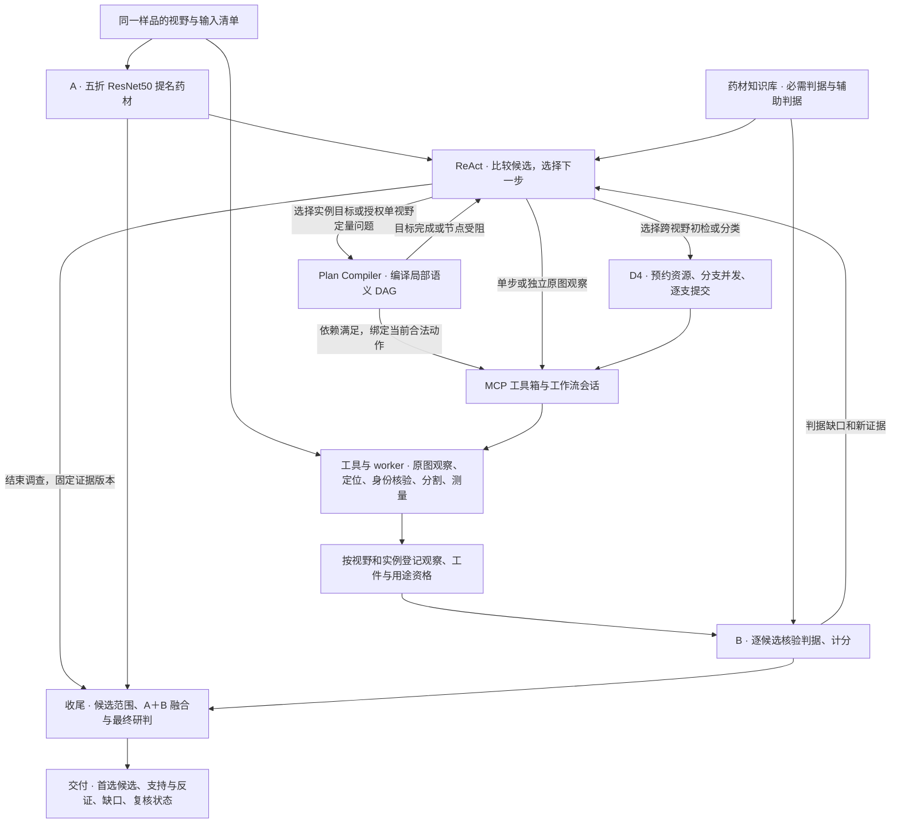
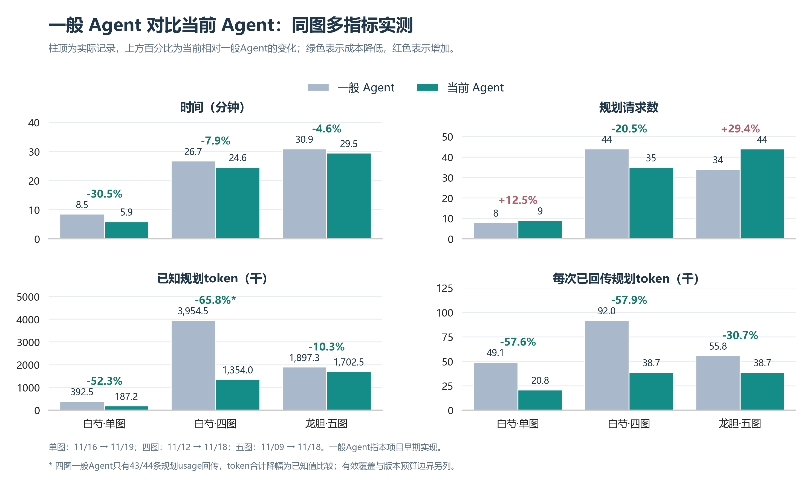
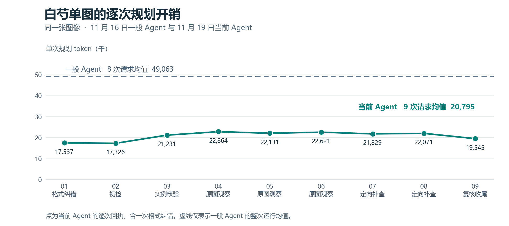
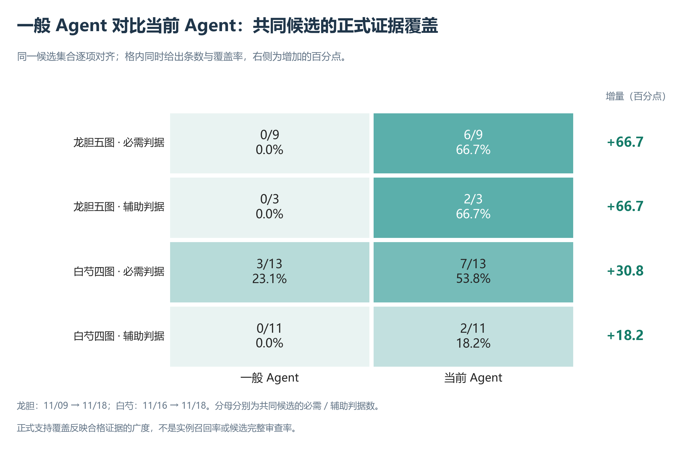
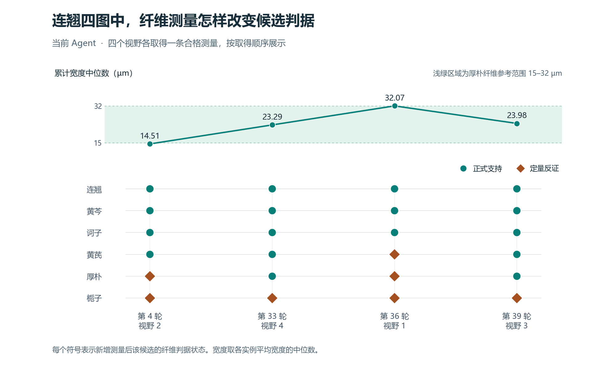

# TCM_Fusion 中药材显微图像鉴别

TCM_Fusion 接收**同一待鉴别样品的一张或多张显微图**。交付结果回答三个问题：最倾向哪种药材，哪些显微证据支持这个判断，还有什么需要复核。每条关键证据可以追回原始视野、实例及本次采用的工件版本。

**正式默认方案为 C＋D4，由 ReAct 主导调查。** C 将选定实例的身份或测量目标编译成局部依赖图。D4 在当轮菜单允许时，并发执行不同视野的同类初检或单实例分类，默认最多四路。Agent 根据证据决定使用哪条路线，主机负责执行资格、资源和证据提交。[正式运行模板](config/multi_view.json)

[架构与数据流](#架构与数据流) · [ReAct 的设计取舍](#react-的设计取舍) · [计划编译与语义 DAG](#计划编译与语义-dag) · [候选调查与证据控制](#候选调查与证据控制) · [并发与回交](#调查执行) · [计分与交付](#计分与交付) · [Agent对比](#架构优化的实测表现) · [部署](#部署准备) · [运行](#运行一次鉴别) · [查看结果](#查看结果)

## 架构与数据流

1. **准备本次样品。** `multi-view` 核对清单、图像内容和依赖，再建立独立运行目录。预检完成后，实跑才执行模型和工具。
2. **A 提名候选。** 五折 ResNet50 对每个视野生成逐折 Top-3。标签映射到知识库候选 ID 或药材组，再汇总为调查候选。候选先验同时用于最后的 A＋B 排序。
3. **ReAct 选要解决的缺口。** Agent 先读已有证据和候选差异，从当轮菜单选择单步、C 的实例目标、D4 的跨视野动作或独立原图观察。只有会影响判断的问题才值得追加取证。
4. **MCP 调用工具，主机更新证据。** 初检和补扫发现实例，分类核验身份，分割与几何测量取得符合用途的量化证据。程序核对视野、实例、依赖和用途后提交工件，用 B 重新评估候选。ReAct 根据新增支持、反证和剩余缺口决定下一步。
5. **收尾并交付。** 调查停止后，按候选范围筛选、计算 A＋B 排序并核对候选资格。最终研判依据冻结证据确定交付候选、结论强度和复核要求，再写出 `output.json` 与 `report.md`。[应用层](lib/application/README.md) · [正式收尾入口](lib/application/workflow_entry.py)



| 谁负责 | 它能决定什么 |
| --- | --- |
| 应用入口与 A | 核验图像清单和摘要，为一个样品建立独立运行。每个视野各取五折模型的逐折 Top-3，再合并候选；只在某一折出现的候选也有机会被查证。盲测参考标签留在事后核对环节。[应用层](lib/application/README.md) · [候选生成](lib/decision/candidate_policy.py) |
| Agent | 读取当前判据缺口、可用实例和预算，选择观察、测量、换路线或请求复核，并留下简短理由。候选的提出、暂停和恢复是调查状态，显微证据由工具取得。[规划与反馈](lib/agent/README.md) |
| MCP、工作流与 worker | MCP 将工具调用绑定到本次样品。每个工具在注册表声明所需技能、参数、权限和前置条件。工作流核对目标、依赖、额度和截止时间，worker 执行获准的视觉或测量任务。并发分支分别准备工件，由协调者逐支发布。[MCP](lib/mcp/README.md) · [工具注册表](lib/tools/tool_registry.py) · [工作流](lib/workflow/README.md) |
| 证据、判据与交付 | 证据层记录对象、来源、版本和用途。决策层按药材知识库核验判据，给出 B 分；应用层在收尾时组合 A、B 并生成报告。最终解释引用冻结证据，引用无效或文本研判失败时由程序生成可追溯的交付。[药材判据库](Agent判药/data/herb_criteria.json) · [证据层](lib/evidence/README.md) · [最终研判](lib/decision/final_assessment.py) |

## ReAct 的设计取舍

显微调查有两种不同的不确定性。看图前，没人知道下一张图会出现哪种结构，也就难以预定整例调查顺序。但在某个实例上，一旦选定“测量宽度”，身份、掩码、标定和测量之间的依赖是已知的。项目把前一种选择留给 ReAct，把后一种依赖交给程序处理。优化的是反复询问模型、重复看图和等待无关分支的开销，同时保留竞争候选改变调查方向的机会。

| 方案借鉴的思想 | 本项目如何采用 |
| --- | --- |
| **LLMCompiler · 分开规划、调度与执行** | 模型选调查目标。主机编译单实例依赖图，等前一步产生真实工件才绑定下一动作。可预见的局部工作能连续推进，遇到需要改变调查含义的问题就交回模型。[语义执行器](lib/agent/semantic_execution.py) |
| **ReWOO · 让推理引用已经取得的证据** | 同一物理观察在规划上下文里保留一份事实，各候选分别引用并解释。模型每轮看到紧凑的当前状态、判据缺口和合法菜单，需要细节时读取完整账本。这样可以少发重复描述，也能在视觉结果偏离预期时立即调整路线。[候选区分问题](lib/decision/comparison_problems.py) · [规划上下文](lib/agent/planning_context.py) |
| **Reflexion · 用执行反馈修订策略** | 本地控制器把失败或停滞绑定到具体问题。模型在下一次正常规划中可以采纳、维持、推迟或拒绝建议；采纳时说明要改变的条件和预期收益。后续用工件、合格证据和缺口变化核对实际效果。反思只作用于本次调查策略。[反思实施说明](融合链路文档/20_判据分值解释与反思策略增量方案.md) |
| **BATS · 把预算和未完成状态带入决策** | 推荐取证路线时计入后续分类、分割、测量可能消耗的资源。派发前检查及预约额度，为最终研判留时间。便宜的原图观察能回答存在性，却不能替代一个定量判据所需的测量。预算不足时，已完成工作和仍不可核验的缺口一起交付。[调查成本估计](lib/decision/candidate_audit.py) · [资源账本](lib/runtime/resource_budget.py) |

正式入口运行一个 ReAct 调查循环。计划编译、证据投影、预算校验和反馈评估由本地程序完成，模型在下一次必要规划中同时选择行动和回应反思。[方法来源与采用边界](docs/方国昊/最终优化计划_v1.1_评估修订稿.md) · [实施与配对验收](融合链路文档/10_ReAct主导的证据优化与语义DAG实施部署方案.md)

## 计划编译与语义 DAG

**以“测量视野一中某个已定位实例的宽度”为例。** ReAct 从当轮菜单选择实例目标，同时说明它要回答的判据问题。当前目标有四类：核验身份、测长度、测宽度、测面积。程序可据此检查模型究竟授权了哪一个实例、哪一种结果。[目标选择协议](lib/agent/planning_choices.py)

1. **编译目标。** Plan Compiler 把“测宽度”展开成局部有向无环图（DAG）：**核验身份 → 取得掩码 → 核验宽度用途及标定 → 取得宽度 → 重算判据**。节点记录依赖、所需事实和何时失效。“核验身份”单独成图时只含第一个节点，执行器不会自行把目标扩大到测量。[目标编译](lib/agent/semantic_execution.py)
2. **运行时绑定。** 实例账本用原图及其坐标识别目标。轮到某节点时，主机重新读取有效工件与合法工具。已有合格身份或已有所需宽度可直接满足相应节点；需要分割时才派发分割，成功后才引用实际生成的掩码。换一个裁图文件名不会凭空多出一个实例，高度重叠但身份有歧义的框也不会被自动合并。[实例账本](lib/evidence/instance_ledger.py) · [工具契约](lib/tools/tool_registry.py)
3. **按结果回交。** 宽度取得后重算判据，ReAct 再决定该比较哪种药材。如果分类发现它是另一类结构、轮廓需复核、标定失效或绑定输入已变，执行器记录受阻原因，停止未执行的后继。模型可以换实例、换视野或提交复核。单个实例目标完成只解决本次局部问题。[执行与回交](lib/agent/react_graph.py)

正式模板也支持从**尚无可靠实例的定量问题**开始。例如，ReAct 可授权“取视野一的导管宽度”。同一 DAG 先复用合格测量或唯一裁图，缺少对象时可在授权范围内定向补扫一次。唯一实例绑定后进入上述流程，多个对象无法区分或测宽资格不足时回交 ReAct。[DAG 的设计边界](融合链路文档/09_DAG与旧短计划边界.md)

D4 负责有限跨视野并发。另一个视野可能先产生结果，怎样交回模型取决于该结果的调查价值。整例的候选、未来裁图和工具顺序在调查中逐步确定。10 号方案总体图中的通用事件总线，以及任意子图收齐指定数量的结果就触发后继（quorum），仍属扩展设计。[D4 运行时](lib/agent/physical_execution.py)

## 候选调查与证据控制

### 用反例辨认容易看错的结构

以针晶为例，如果只告诉模型“寻找细长、尖锐的结构”，一束纤维也可能符合描述。项目为容易混淆的特征配了**有具体形态理由的反例**。查针晶时，提示同时保留“可散在，也可成束密集”的正例，并提醒观察细长结构有没有连续的细胞壁和胞腔，或有没有导管的环纹、网纹。这样，模型有理由重新检查疑似纤维的框，也有理由保留紧邻成束的真针晶。反例随当前调查目标切换：查纤维时，同样的细胞壁和胞腔就成为辨认纤维的线索。[特征描述配置](config/multi_view.json) · [反例选择依据](config/negative_feature_bank.json)

反例的选择来自检测错误分析。针对针晶，纤维等易混组织是重点对照，簇晶、方晶和花粉粒只作辅助对照。淀粉粒在这次分析中更突出的问题是漏检和标注粒度，把它列为主要负例反而偏离了要解决的问题。对需要目检的裁图，Agent 还可调用**图像示例审计**，把待查目标、同类正例和易混反例放在同一张图上，让模型比较可见形态并说明理由。这条意见供复核使用。要形成针对某种药材的反证，还需落实到该候选的正式判据，例如身份和标定均合格的实例，其实测尺寸落在该候选参考范围之外。[示例审计](lib/vision/image_exemplar_audit.py) · [证据采信规则](lib/evidence/evidence_projection.py)

### 让竞争候选参与决定下一步查什么

每轮先让所有活动候选与已有证据对照，再决定下一次观察是否值得付出成本。推荐动作优先考虑能区分候选的判据、从当前实例能否走到合格结果、还需多少调用，以及一次调查能服务哪些候选。某个候选的必需项尚未满足时，系统暂不为它单独推荐只补辅助项的动作；其缺口继续对 Agent 可见，同一动作若能解决另一候选的必需项，仍可选用。推荐顺序给 Agent 取舍，工具资格和预算由主机执行。[候选审查与推荐](lib/decision/candidate_audit.py) · [规划菜单](lib/agent/planning_choices.py)

例如，两个候选都要求观察导管，同一视野只需回答一次“这里能否看见导管”。看图模型收到的是特征描述，候选药材名留在规划层，减少预期答案对观察的引导。找到导管后，Agent 再比较两者对形态或直径的要求。如果同一条观察对两者都成立，它可以被双方引用，却仍解释不了为什么其中一个应排在前面。这时，**查一项能区分两者的判据**，通常比再找一个相似的导管更有价值。[候选比较设计](lib/decision/comparison_problems.py)

### 把证据能说明的范围保留下来

项目按样品综合多视野，按视野和实例限定每条观察能回答的问题。YOLO 初检或定向补扫可以产生裁图；裁图 CNN 支持批量初判，低置信或待定实例可再由 Agent 选择单体复核。原图中合格的定性观察可以支持相应存在性判据，疑似框可以引导定位。要回答“这个实例的直径是否符合判据”，则要有匹配的身份、适合该用途的分割轮廓、同一视野的可信比例尺和实际测量值。上游工件被替换后，依赖旧版本的尺寸失效。[视觉工具](lib/vision/README.md) · [实例账本](lib/evidence/instance_ledger.py) · [证据版本](lib/evidence/evidence_store.py)

因此，“未查”“本视野未见”“调用失败”和“有合格反证”分别记录。例如，视野一未见纤维，视野二仍可继续寻找。某个已确认实例的合格尺寸落在候选的参考范围外，才构成针对该候选这条尺寸判据的反证。收尾时的特征审计读取当前有效的初检、补扫、批量分类等工件，供人工目检；审计意见本身没有给 B 加分的权限。[证据采信](lib/evidence/evidence_projection.py) · [特征审计](lib/vision/feature_audit.py)

规划和收尾共用同一份**证据资格投影**。它为每个候选标出可引用的支持、合格反证、仅供调查的线索和未解项。一个视野新增无关工件，不会改变已有事实的引用 ID。待核验分类可以进入暂定分析，正式 B 分只读取符合相应用途的证据。这使规划器提出的理由和最终报告可用同一出处核对。[证据资格投影](lib/evidence/evidence_projection.py) · [暂定证据](lib/evidence/provisional_evidence.py)

### 用下一步取得的证据评价反思

一次工具执行成功，可能只是多了一个裁图，也可能真正解决了一条判据。系统分别记录动作是否成功、是否解锁后继，以及证据或裁决发生了什么变化。例如，连续处理边界不清的目标仍得不到可用尺寸，Agent 可以选择换视野。下一轮用实际产生的合格测量和判据变化检查这条建议是否奏效。持续没有进展时，可以带着未解问题请求复核。这使复核者能从同一条轨迹追到“建议了什么、实际做了什么、得到了什么”。[任务内反思](lib/agent/reflection_controller.py) · [动作反馈](lib/agent/action_feedback.py)

这里有两项细粒度控制。首先，按实例、输入和方法识别**同一次尝试**，无变化的重复请求受到限制，换视野、改变方法或取得有效修复输入后可以重新调查。其次，复核是合法出口。如果模型想结束而证据尚不足以确认，系统可直接交付复核；收到停止建议后连续两次继续且仍无进展，也会保留现有证据并收尾。操作终止原因和药材能否确认分别进入报告。[调查控制](lib/agent/investigation_control.py) · [停止与复核](融合链路文档/13_调查建议与硬约束分离.md)

## 调查执行

ReAct 保留每次调查方向的选择权。**C 处理同一实例内的前后依赖，D4 处理不同视野间的独立工作。** 项目把两者放在同一个规划菜单里，单图和多图共用这套入口。[调查主循环](lib/agent/react_graph.py) · [正式参数](config/multi_view.json)

| Agent 的选择 | 如何执行，何时交回规划 |
| --- | --- |
| 单步调查 | 只选一次原图观察、初检、补扫或实例操作。若第二个视野只是第一个失败后的备选，等第一步出结果后再决定是否动用它。 |
| C · 同一实例的语义目标 | 一次授权完成选定目标。每个实际工具仍独立检查资格和额度，目标完成或受阻时回交规划。[计划编译与语义 DAG](#计划编译与语义-dag) |
| C · 单视野定量问题 | ReAct 选择视野、特征和量纲。串行 DAG 复用证据、解析实例，再返回可追溯测量或回交原因。[问题授权边界](融合链路文档/09_DAG与旧短计划边界.md#单视野鉴别问题的授权入口) |
| D4 · 跨视野物理并发 | Agent 可显式选择 2～4 个不同视野，用同一种工具做初检，或各取一张裁图做单实例分类。选择时逐路考虑“即使其余分支都得到理想结果，这一路是否仍值得做”。主机检查独立性、依赖、额度和剩余步数，并逐支提交有效结果。[并发调度](lib/workflow/physical_schedule.py) |
| 成组原图观察 | 两个可独立回答的原图问题也可以一起发出。这类观察等两份结果汇合后再进入下一轮规划。[规划选择](lib/agent/planning_choices.py) · [观察执行](lib/agent/react_graph.py) |

**D4 的第一个分支完成时，会立即唤醒规划吗？** 结果要先被主机接纳，并且解锁新的实例操作、解决判据、新增合格反证或改变规则判定。此时若还有分支在运行、还有规划步数，就能提前交回（`physical_partial`）。例如，视野一先检出可分类裁图时，Agent 可以选择对它做单实例分类，视野二继续初检。其他有依赖的动作等本组汇合后重新核对。普通完成回执可以一起处理，收齐时记录 `physical_join`。[分支结果收集](lib/agent/react_graph.py) · [并发执行器](lib/agent/physical_execution.py)

**怎样避免快慢分支相互污染？** 派发时固定每支实际读取的工件、允许写入的视野范围与预算预约。worker 在私有目录准备结果，由一个协调者核对依赖后发布。重复回执只生效一次，任务关闭后迟到的结果不会改写最终证据；远端是否已经计费无法确定时，资源账本记为未知。[并发提交与对账](lib/workflow/physical_schedule.py)

龙胆五图展示了最新架构相对早期的变化。11 月 9 日旧版与 11 月 18 日部署后的同图运行，共同候选的正式支持由 0/12 增至 8/12；后者核验了龙胆的针晶、表皮细胞，还取得桔梗分泌组织宽度 5.12 μm、低于其 14–25 μm 参考范围的反证。两次分别耗时 1,854.09 和 1,768.71 秒。该案的主要改善是更广的候选判据支持与竞争解释核验。[早期记录](测试运行总报告.md#archive-case-02) · [最新架构代表运行](测试运行总报告.md#archive-case-35)

## 计分与交付

### 分数字段

| 输出字段 | 用途 |
| --- | --- |
| `a_probability` | A 分类先验。用于提名后各候选的融合排序。 |
| `rule_score` | B 的正式证据分，用于 B 排序、分差和裁决。`b_confidence` 和 `confidence` 是该分数的兼容字段。 |
| `fused_score` | A＋B 的融合排序分。交付候选可以据此重排。`top_candidate.score` 以及兼容字段 `formal_score` 在此交付结构中通常也是融合分。 |
| `provisional_score` | 暂定排序分，用于证据不足时保留待核验线索。正式 B 分和正式支持数各自独立计算。 |
| `raw_score` | 原判药引擎的未归一化原始分，用于审计原始贡献和扣分。 |
| `support_count` | 合格支持覆盖的独立特征类数，包含必需与辅助特征。查看 `score_components.supporting_contributions` 可知道哪些独立辅助项实际加分。 |

A 是模型输出的先验，融合分、B 分和暂定分都有各自的排序或判定用途。报告直接给出证据、判断档位和复核标记，分数没有经过样品正确率校准。[输出投影](lib/decision/output_projection.py) · [评分字段口径](lib/decision/README.md)

### A 先验与融合分

设 `N` 为所有视野提供的逐折结果数量。一个候选可能对应多个标签，例如药材组。先在每一折把映射到该候选的概率相加，再按全部折取平均。

```text
A(c) = 各视野、各折中映射到候选 c 的概率之和 ÷ N
F(c) = (A 权重 × A(c) + B 权重 × B(c)) ÷ (A 权重 + B 权重)
默认 F(c) = 0.50 × A(c) + 0.50 × B(c)
```

**逐折 Top-3 用来生成调查候选（平均有8~10候选组成员），A 分从完整逐折排名取值。** 例如四图、每图五折时，A 分的分母为 20。候选在某一折的原始记录没有对应条目时，该折对它的贡献为 0。融合首位发生变化时，程序撤销与原首位绑定的结论并交由收尾复核。[候选生成](lib/decision/candidate_policy.py) · [A 预测适配](lib/workflow/adapters.py) · [A＋B 计算](lib/decision/ab_fusion.py)

### B 规则分（b-rule/4）

每条判据的正贡献来自 `判据权重 × 核验状态系数 × 形态合理度 × 丰度系数 × 来源可靠度`。例如附有量程且实测合格的 `IN_RANGE` 系数为 1.0。`NO_REF` 的状态系数为 0.6，当该判据本身没有量程且证据满足相应用途时，可以作为定性支持。仅凭通用阳性无法核验具体形态时记 `MORPHOLOGY_UNVERIFIED`，该条正贡献为 0。缺少合格量纲或实测超界的判据也不能给正式 B 分提供正支持。[逐项判据核验](Agent判药/scripts/rule_engine.py) · [证据采信](lib/evidence/evidence_projection.py)

设 `W` 为全部 required 的权重和，`P` 为合格 required 的正贡献和。`D` 是 required 判据的实测超界罚、必需证据缺失罚和不符特征出现罚之和。`C` 是上限，`S` 是按合格必需贡献加权得到的场景系数。`E` 为各独立 supporting 的最高合格贡献之和，已列为 required 的同类特征不再计入 E。

```text
R0 = clip((P − D) ÷ W, 0, 1)    W 为 0 时取 0
R  = min(C, min(R0, C) × S)     无有效必需正贡献时 S 取 1
基础分 = 0.80 × R
佐证加分 = 0.20 × R × E ÷ (1 + E)    全部 required 合格才计入，否则为 0
分离区间反证扣分 = 0.20 × K ÷ (1 + K)
B(c) = max(0, 基础分 + 佐证加分 − 分离区间反证扣分)
```

同一组有资格的实例测量在同一特征、同一量纲下支持一个候选，并对参考区间与之分离的另一候选判为超界时，计入后一候选的独立反证。每种特征只取一次该候选的原超界罚项，各特征相加为 `K`。例如 G1 的导管 25–78 µm 与 G2 的 10–24 µm 分离，合格实测 20 µm 时，G1 在合成离线对照中由 0.408 降至 0.341333。逐笔依据见 `score_components.disjoint_counterevidence`。[离线对照](运行结果/模拟G1G2导管区间反证_11月19日18时25分06秒/运行摘要.md)

默认 `C=1`。单项合格必需判据的量程跨度至少 60 μm 且占必需正贡献至少 55% 时，上限为 0.60。判据依据为非药典正文时，上限为 0.49。两条都触发时取较低上限。原引擎的 `raw_score` 则保留原始各项贡献之和扣除原引擎罚项，读取当前正式分时以 `rule_score` 为准。[B 正式计分](lib/decision/rule_scoring.py)

### 暂定排序分

对候选自己的判据做加权平均得到 `Q = Σ(判据权重 × 暂定状态权值) ÷ Σ判据权重`。分母为零时 Q 取 0。已核验定量状态权值为 1.0，合格定性线索和待核验检出为 0.5，部分匹配为 0.25，冲突、未检出和未知为 0。`provisional_score = 0.60 × A + 0.40 × Q`。它帮助选出值得保留的暂定对象，仍需用正式证据完成裁决。[暂定排序](lib/evidence/provisional_evidence.py)

### 从分数到判断

1. **先做 B 裁决。** 首位 required 全部满足、B 分至少 **0.50**、独立支持默认至少 **2 类**，才进入倾向判定。首位 B 分达到 **0.75**，且领先第二名至少 **0.10** 时，单一药材可进入确认档。领先不足 **0.10** 时保留复核要求。达到强分档的单类证据可形成条件结论并保留复核。
2. **再做候选范围与融合。** 默认 `open_strict` 保留已映射的 A 候选。A 名单外的候选须满足全部 required 和 supporting，且至少一项必需特征具有特异性，才可参与融合排序。
3. **最后核对交付资格。** 检查结论候选是否与证据引用一致，并结合强制场景、未映射候选和未完成的候选审查决定复核。证据授权到药材组时可交付 `group_level`。尚需复核但可交付首选时记 `tentative`，无法交付首选时记 `undetermined`。[B 裁决](lib/decision/rule_scoring.py) · [候选范围](lib/decision/candidate_scope.py) · [最终研判](lib/decision/final_assessment.py)


## 部署准备

命令从本目录运行。仓内的 Plan A、YOLO、Stage2、原分割与测量组件由 [paths.py](paths.py) 定位。搬迁后重新登记三个本地环境。安装方法、模型摘要和远端服务配置见 [独立部署](独立部署.md)。

## 运行一次鉴别

### 1. 准备输入清单

把同一样品的待测图片放在一个目录内。至少选择一张，按预期顺序列出每张图的文件名和 SHA256。路径须在输入目录内，路径和图像内容各自唯一。盲测时使用中性目录及文件名，参考答案保留在独立的结果核对记录中。

在新的输入目录中，可用以下命令生成单图清单。多图只需在 `$views` 中按顺序追加文件名。

```powershell
$source = 'D:\tcm-input\S01'
$views = @('view01.jpg')
$manifest = @{
    views = @(
        foreach ($view in $views) {
            $image = Join-Path $source $view
            @{ view = $view; sha256 = (Get-FileHash -LiteralPath $image -Algorithm SHA256).Hash.ToLowerInvariant() }
        }
    )
}
[System.IO.File]::WriteAllText(
    (Join-Path $source 'input_proof.json'),
    ($manifest | ConvertTo-Json -Depth 4)
)
```

入口默认读取输入目录中的 `input_proof.json`。已有独立清单时，在预检和实跑命令上都传入 `--manifest` 指定其位置。

### 2. 预检并实跑

默认使用仓内视觉环境运行 Plan A，也可显式指定兼容解释器。使用相同参数先做预检，再创建一次独立的真实运行。预检会校验图片、准备任务配置并写出本地就绪报告。真实运行会按所选动作调用视觉服务，可能产生 API 费用。

```powershell
$python = '.\.venv\Scripts\python.exe'
$aPython = '.\.venv\vision\Scripts\python.exe'
$runArgs = @(
    '-X', 'utf8', '-m', 'TCM_Fusion.cli.main', 'multi-view'
    '--source-dir', $source, '--a-python', $aPython
    '--subject', 'S01', '--purpose', '显微鉴别', '--json'
)

& $python @runArgs --dry-run
if ($LASTEXITCODE -ne 0) { throw '预检失败，请查看 doctor.json 或终端错误' }

& $python @runArgs
```

每次调用独立创建 case 目录并生成中性图像副本。默认输出到 `运行结果/`，用 `--output-root` 可另指定落点。目录名采用 `实测龙胆_11月19日14时30分25秒` 这类简名。预检以 `模拟` 开头，图数和目的登记在运行状态中，同秒重名时追加序号。已归档结果见 [测试运行总报告](测试运行总报告.md)。预检的 JSON `directory` 指向 case 根，真实运行的 `directory` 指向正式工件目录 `runs/fusion_<id>/`。[运行目录命名与索引](运行结果/README.md)

## 查看结果

| 要确认的问题 | 从哪里看 |
| --- | --- |
| 输入是否准备好，任务是否完成 | case 根的 `input_proof.json`、`doctor.json`、`interface_status.json`。完成后用 `run_location.json` 定位正式工件。 |
| 最终判了什么，是否需要复核 | `output.json` 中的 `status`、`top_candidate`、`review_required`，以及供人工阅读的 `report.md`。 |
| 结论依据与缺口是什么 | `final_assessment.json` 记录候选比较、复核原因和终止原因。用 `final_evidence.json` 追到对应证据和资格。 |
| 同一个候选的 B 分和融合分是怎样得到的 | 在 `agent_verdict.json` 的 `ranking` 找到候选 ID，对照 `score_components` 中的必需基础分、佐证加分和分离区间反证扣分，再看 `rule_score`、`a_probability` 和 `fused_score`。 |
| 为什么选了这个动作，另一条路线当时可选吗 | `agent_trace.json` 中的 `planner_offer` 留下实际提供的菜单，`thought` 留下所选动作及简短理由。结合后续动作反馈看它是否解决了原问题。 |
| 实例目标执行到哪一步，并发有无提前交回 | 选过语义目标时，`workflow/semantic_plan.json` 记录最近目标的节点状态和结束原因。按时间查看 `agent_trace.json` 的执行事件，`physical_partial` 表示部分结果触发规划，`physical_join` 表示该组收齐。 |
| 哪个计算阶段失败，耗时花在何处 | `workflow/operations.json` 查看阶段终态，`workflow/action_timeline.json` 查看时间线，`workflow/ops/` 查独立 worker 工件。网络请求已预留但关闭任务时还没有回执，资源账本 `workflow/resources.json` 会以 `unknown` 收尾。 |
| 候选为何被暂停，换路线有没有效果 | 有假设更新时看 `workflow/investigation.json`。在 `workflow/reflection_controller.json` 中分别核对反思建议、实际采纳的策略及后续动作效果。 |
| 哪一版裁图或掩码参与了裁决 | 用 `final_evidence.json` 的 `evidence_version` 定位 `workflow/evidence/versions/<版本>.json`，按工件 ID、父依赖和摘要回查对应文件。 |
| 如何目检裁图和 mask | `feature_audit/feature_audit.json` 按有效证据版本登记裁图、分类和 mask。正式采信以最终证据和研判工件为准。 |

### 最终输出类型

读取 `output.json` 时，将 `status`、`top_candidate` 和 `review_required` 一起看。前者表示可交付的判断强度或范围，后两项说明本次交付了哪个首选，以及是否需要复核。[交付状态生成逻辑](lib/decision/output_projection.py)

| `output.json.status` | 含义 |
| --- | --- |
| `confirmed` | 确认到单一药材。证据达到 B 的确认档位，并通过最终交付校验。 |
| `probable` | 倾向某个单一药材。证据达到 B 的倾向档位，并通过最终交付校验。 |
| `group_level` | 结论到药材组。首选的 `kind` 为 `group`，报告保留组内身份待区分的范围。 |
| `tentative` | 当前有一个可交付的暂定首选，`review_required=true`。附上已有证据和仍待解决的判据。 |
| `undetermined` | 当前无法交付首选，`top_candidate=null`，`review_required=true`。 |

`audit.rule_verdict` 保留交付前的规则裁决，其中可以出现 `insufficient_evidence`。例如，B 裁决为 `probable`，但竞争候选的审查仍有缺口，最终可以交付 `tentative`。任务是否执行完成则查看 case 根的 `interface_status.json`。一次 `completed` 的任务也可以交付暂定结果。[B 规则裁决](lib/decision/rule_scoring.py) · [最终研判](lib/decision/final_assessment.py) · [任务状态](lib/application/multi_view.py)

### 连翘四图的实际输出

11 月 19 日连翘四图实跑使用 `b-rule/3`。唯一的 required 是纤维，已取得合格定性支持。原判据贡献为 0.24、该项权重为 0.50，因此 `R = 0.24 ÷ 0.50 = 0.48`。独立佐证加分为 0，得到 `B = 0.80 × 0.48 = 0.384`。A 分与 B 分等权融合后为 0.531722，计算时使用未四舍五入的 A 值。

```json
{
  "rule_score_version": "b-rule/3",
  "status": "tentative",
  "top_candidate": {
    "id": "连翘",
    "a_probability": 0.679445,
    "rule_score": 0.384,
    "fused_score": 0.531722,
    "provisional_score": 0.607667,
    "raw_score": 0.24,
    "support_count": 1
  },
  "review_required": true,
  "audit": {
    "rule_verdict": "insufficient_evidence"
  },
  "final_assessment": {
    "termination": {
      "route": "planner_request_review"
    }
  }
}
```


### 复核与调查终止

常见复核原因包括必需判据未满足、独立支持特征不足、B 分领先幅度不足、竞争候选尚未查清、A 候选未映射，以及必做的场景检查未完成。身份、掩码或标定不合格时，相应的尺寸证据继续留在缺口里。预算、时间或工具能力不足时，交付可以保留已取得的证据和未解问题。[候选审查](lib/decision/candidate_audit.py) · [停止条件](lib/agent/react_graph.py)

#### 常见调查终止码

在 `agent_trace.json` 中查看 `stop_reason`，同一个值也会写入 `final_assessment.json` 的 `termination.route`。若运行时另外记录了具体触发原因，可在 `termination.reason` 中查看。[终止码生成](lib/agent/react_graph.py) · [终止字段映射](lib/decision/final_assessment.py)

| `stop_reason` / `termination.route` | 含义 |
| --- | --- |
| `planner_request_review` | 调查以复核动作收尾。Agent 可以主动选择 `request_review`，即使还有合法动作可做。模型提出 `finish` 但被程序转为复核时也会得到此码，可从 `stop_projected_to_review` 事件查到具体的 `qualification_blockers`。 |
| `planner_finish` | Agent 选择 `finish`，程序接纳该选择并结束调查。交付的判断档位见 `output.json.status`。 |
| `runtime_request_review` | 运行时在规划无法继续时转复核。用 `termination.reason` 追查原因，例如 `planning_budget_exhausted`（规划所需资源不足）或服务错误。 |
| `no_progress_after_advice` | 收到停止建议后连续两次继续调查，仍未取得新证据或解锁下一步。 |
| `no_legal_action` | 当前没有合法动作可继续。 |
| `max_steps` | 达到本次调查的执行步数上限。 |
| `finalization_time_reserve` | 调查提前收尾，给最终研判留出时间。 |
| `workflow_deadline` | 到达工作流的硬截止时间。 |

要解释证据上为什么需要复核，查看 `final_assessment.json` 的 `review_reasons`，再结合 `output.json` 的 `missing_required` 和候选逐项判据。例如，同一次运行可以同时记录 `planner_request_review`（调查以复核动作收尾）、`tentative`（交付暂定首选）和 `review_required=true`（需复核）。


<a id="架构优化的实测表现"></a>
## 一般 Agent 对比当前 Agent

“一般 Agent”指本项目D1–D4部署前的历史实现；“当前 Agent”包括11/19最新单图、多图实跑及11/18同架构的历史代表运行。以下固定三个同图场景做直接量化对照，全部**35次运行记录**另存数据表，含过渡版本、消融和中止记录。

### 效率与调查成本

三个同图场景中，当前 Agent 每次规划请求的平均 token 消耗下降 **30.7%–57.9%**，端到端耗时下降 **4.6%–30.5%**。白芍单图和龙胆五图的规划请求数分别从 8 次增至 9 次、从 34 次增至 44 次。



| 同图对照 | 一般 Agent | 当前 Agent | 主要变化 |
| --- | --- | --- | --- |
| **白芍单图，11/16 → 11/19** | 8请求；509.59秒；392,507规划token | **9请求／8有效thought；354.351秒；187,155规划token** | **token下降52.3%，耗时下降30.5%**；每请求token下降57.6% |
| **白芍四图，11/12 → 11/18** | 44请求；1,603.97秒；每次已回传规划token91,965 | 35请求；1,476.77秒；每次38,686token | **每请求token下降57.9%**，请求数下降20.5%，耗时下降7.9% |
| **龙胆五图，11/09 → 11/18** | 34请求；1,854.09秒；1,897,254规划token | 44请求；1,768.71秒；1,702,479规划token | **多取得8条正式支持**；耗时下降4.6%，规划token下降10.3% |

白芍单图中，当前 Agent 最贵的一次规划用了 **22,864 token**，仍低于一般 Agent 的同图单次均值 **49,063**。图中计入首次格式纠错的 17,537 token。另一次因签名变化中止的单图运行（153.459 秒、72,638 规划 token）与 11/11 白芍四图短流程（400.75 秒）均单列于数据表。



### 候选组检验与合格证据

| 同图候选判据覆盖 | 一般 Agent | 当前 Agent | 改善 |
| --- | ---: | ---: | ---: |
| 龙胆五图，共同候选正式支持 | **0/12** | **8/12**（必需6/9、辅助2/3） | **+66.7个百分点** |
| 白芍四图，共同候选必需支持 | **3/13** | **7/13** | **+30.8个百分点** |
| 白芍四图，共同候选辅助支持 | **0/11** | **2/11** | **+18.2个百分点** |



| 当前实跑 | 规划请求／有效thought | 运行秒数 | 规划token | 候选完整审查 | 判据已审查 |
| --- | ---: | ---: | ---: | ---: | ---: |
| [白芍单图](测试运行总报告.md#recent-154610) | **9／8** | **354.351** | **187,155** | **1/5，20.0%** | **5/14，35.7%** |
| [连翘四图](测试运行总报告.md#recent-133903) | **41／41** | **1,838.224** | **1,520,108** | **5/9，55.6%** | **11/16，68.8%** |

白芍单图取得簇晶 **13.77μm** 的合格测量，满足其11–35μm必需判据；连翘四图保留3类带标定测量、候选尺寸反证及2项改判为纤维的分类记录。两案均交付暂定结果、需复核。单图和四图来自不同样品组，审查比例分别描述各案。

连翘四图中，**6 个候选**共用同一组纤维测量。厚朴的纤维参考范围为 15–32 µm，第 36 轮累计中位数升至 **32.07 µm**，该判据转为反证。第 39 轮补入第四个视野后，中位数回到 **23.98 µm**，厚朴重新获得支持。到这一步，纤维判据支持 5 个候选，对栀子构成反证。




*对照沿用各次运行的版本与预算；11/12每次token按43/44条已回传usage计算。正式支持覆盖不等于特征召回率；易混淆分辨正确率及全案token尚缺完整真值和报量。*

## 源码与文档

| 想追踪的内容 | 入口 |
| --- | --- |
| 从 CLI 到任务收尾 | [主入口](cli/main.py) · [应用层](lib/application/README.md) |
| Agent 怎么选动作，工具怎样受控执行 | [Agent](lib/agent/README.md) · [MCP](lib/mcp/README.md) · [工具](lib/tools/README.md) · [工作流](lib/workflow/README.md) |
| 工件如何入账，证据怎么进入裁决 | [证据](lib/evidence/README.md) · [决策](lib/decision/README.md) |
| 从样品准备到运行定位 | [单图手册](单图测试操作手册.md) · [多视图方案](多图测试运行方案.md) |
| 配置、回归与其余组件 | [配置导航](config/README.md) · [测试导航](tests/README.md) · [源码导航](lib/README.md) · [设计文档索引](融合链路文档/00_INDEX.md) |

本地回归与录制工件回放分别从以下入口进入。

```powershell
& $python -X utf8 -m TCM_Fusion.cli.main selftest
& $python -X utf8 -m TCM_Fusion.cli.offline workflow-replay --help
```
