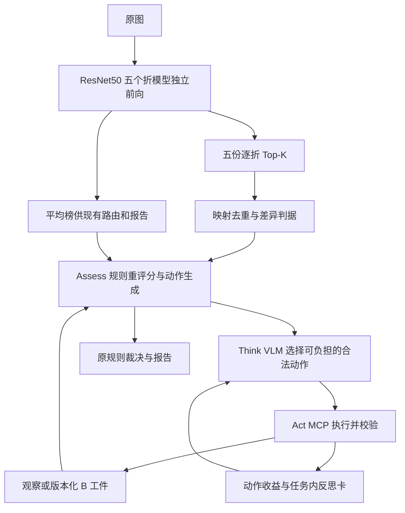

# A/B 融合与 LangGraph 主动证据 Agent v2

广州农检-融合链路

从选图、映射和真实 v2 单图测试开始，见 [单图测试操作手册](单图测试操作手册.md)。历史故障和复测结果统一见 [测试与调试经验](../融合链路/测试与调试经验.md)。

CODE-020（2026-11-04）：新融合分割默认使用中心区域/唯一连通域关联，中心单点未命中不再单独拒绝；原B基线默认不变。配置`agent.workflow.box_association="center_point"`可回退；新策略名为`region_component`。疑似截断、关联不明、极性和外溢仍复核；详见[实现与验证](修改记录.md#code-020-details)。仅新运行生效，历史产物不自动重评。新的在线运行从原图启动，不默认复用跨实验快照。

同步日期：2026-11-04｜DOC-040：融合包迁至 `TCM_Fusion`，启动入口为 `python -m TCM_Fusion.cli.main`。分层 QA 与 Reflection 的实施说明见 [CODE-017 验收](修改记录.md#code-017-details)。

运行提醒：凭据和独立OCR环境已就绪，真实GLM规划、检测及Flash分割已执行。服务404不再触发局部图像重检；模型配置改变后需新建任务。单图仍因mask质量不足进入复核，详见[测试与调试经验](../融合链路/测试与调试经验.md)。

**结构功能见[实施与审查记录 CODE-006](修改记录.md#code-006-history)，最新运行结论见[修改记录](修改记录.md)。** §1–11保留既有入口和历史批次说明；新工作流无需等待B完整成功。在线接口已做单例联调，识别增益与真实风险放行仍未验收。

本文件是现役运行说明；[修改记录](修改记录.md)追踪全部修改。

### CODE-017新策略（显式启用）

`agent_policy=adaptive_v1`解除正常模式中补查对测量的总依赖；`max_parallel=2`支持独立观察与物理阶段并发；`quality_evaluation=purpose_v1`启用原因码和五种用途资格，原始igm_review和原decide保留，只有受信适配投影进入规则。默认legacy路径不变。QA参数仍是未校准trial，独立风险/覆盖率及灰度验收尚未完成。

安全预览：[adaptive_quality.example.json](config/adaptive_quality.example.json)，默认shadow、零API。真实旧工件回放与待补查动作见[CODE-017报告](修改记录.md#code-017-details)。新增quality-replay、outcome-evaluate、quality-report、ablation-report命令，均可用--help查参数。LangMem验证新增truth/workflow_truth模式，允许有证据纠错但禁止新增错误、训练/开发泄漏和未覆盖观察；旧等价回放模式保留。参考标签必须明确label_scope，图像类别不能自动充当样品鉴别真值。

### CODE-014：复用中间产物的联调模式

用户要求先贯通再优化质量门，可显式设置`agent.workflow.quality_policy="diagnostic_review"`（默认`strict`）。它允许已有`review` mask导入并执行真实几何测量，不把状态改成ok；原`igm_review`旗标、规则丢弃逻辑、P0/场景/标定/权限/预算均保留，最终报告强制`diagnostic_only=true, needs_review=true`。仅联调，不得作为质量合格或识别正确的验收结果。`empty/full`仍不导入为可测量mask。

本例零API配置：[cpu_reuse_config.json](../results/ui_out/fusion/verification/CODE-014/cpu_reuse_config.json)。从已有真实crop/mask启动，命中真实A缓存，只启用measure_instances，经真实MCP运行原measure.py、规则引擎和融合输出。用既有`run --config`入口可复现；该配置采用heuristic、无LLM/新视觉调用，和在线LLM模式分别记录。在线配置中的工具也仅启用测量，观察至多1次、规划至多3次，避免重检/生图。

原B交付常有`crops`和`masks/crops`同源副本；相同内容只导入一次，重复ID但元数据/像素不同则拒绝为`CROP_IMPORT_CONFLICT`。原目录只读，所有新测量写独立run。详见[CODE-014续跑记录](../融合链路/测试与调试经验.md)。

**现在的 Agent 会执行观察工具、更新证据卡、重新调用原规则引擎，再依据新结果决定下一步。** 原 v1 的双路/影子模式仍兼容；主动模式通过 `agent.mode=active` 显式启用。

当前dataset已有图像、A五折权重已通过真实CPU推理；根venv负责Agent/MCP，`.venv/vision/Scripts/python.exe`负责原B视觉阶段（继承已有Anaconda CV依赖）。LangGraph、MCP与真实LLM/VLM已单例联调；准确率和费用改善尚未验证。离线演示中的替身不能作为识别提升证据。

## 1. 当前链路



真实 A 的前向结果分别写入 `fold_rankings`，默认每折取 **Top-3**。每折保留独立名次和分数，Agent 对可映射的药材去重后查证。五折最多给出 15 个原始位置，实际候选数视重复及知识库映射而定。B 有有效正支持的前 3 个规则候选也可参与补查。平均榜用于现有路由和对照报告，逐折模式的 Agent 不用平均榜生成候选或决定停止。

## 2. LangGraph 与 MCP

LangGraph `StateGraph` 执行 `assess → think → act → assess`。Assess 以 B 证据生成合法动作和停止建议，Think 用 GLM 选择，Act 经 MCP stdio 或本地注册表执行、校验并提交。原规则 `decide` 负责裁决。依赖和历史版本见[环境锁定文件](requirements-agent.lock.txt)及[修改记录](修改记录.md)。

## 3. ReAct 与 Reflection

- 实测主路径是 `adaptive_v2 + llm + mcp + active`。模型看到预算内全部合法动作及停止选项，从当轮短编号选择。候选 Top-3 与动作数量是不同的限制。参数由运行时绑定，记录简短 `decision_summary`。
- 规划、观察、重算和首次检测分池，并受全局网络、总资源和时间限制。覆盖软停止建议时给理由；证据不足、强制场景或待修依赖可否决确认。超过步数、时间或重提边界时保留复核。
- 任务内 Reflection 在连续无有效进展达到阈值或动作执行失败时生成结构化卡；adaptive_v2 会根据新失败刷新卡，提示质疑当前假设，而不是强制换区域。离线 Reflection 与 LangMem 单独验证和发布，真实链路没有自动读取参考真值或发布策略。

详见[决策协议](融合链路文档/05_决策协议.md)和[验收入口](融合链路文档/07_验收与运行.md)。

## 4. 运行时技能与 MCP

基础领域技能示例。证据查询与工作流修复技能见工具清单。

| 技能 | 文件 | 工具与职责 |
|---|---|---|
| scene_context | [SKILL.md](skills/scene_context/SKILL.md) | 结晶触发场景强制检查；不传A答案或药材候选 |
| differential_presence | [SKILL.md](skills/differential_presence/SKILL.md) | 选择缺失required P1/C，禁止P0和尺寸伪造 |
| evidence_stop | [SKILL.md](skills/evidence_stop/SKILL.md) | 停止/复核与证据边界 |

技能由 [registry.json](skills/registry.json) 注册，内容被实际加载进规划上下文，哈希进入技能元信息。它们是本项目的领域技能卡，不是自动安装到Codex的插件；Markdown不能自行扩大代码权限。

MCP服务器真实暴露7个工具：`list_skills()`、`get_skill(skill_id)`、`read_evidence()`、`observe(action)`、`list_tools_registry()`、`read_tool(name, arguments)`、`recompute_tool(action)`，并提供 `microscope://skills` resource 与 `collect_evidence` prompt。服务一次绑定一个样品，不接受任意路径。观察服务自己校验合法集合、必查顺序、预算和持久去重；不是给普通函数换MCP名字。

```powershell
# 项目根启动；context由一次active运行或MCP演示生成
.\.venv\Scripts\python.exe -X utf8 -m TCM_Fusion.cli.mcp_server --context <生成的mcp_context.json绝对路径>
```

上面尖括号为需替换的参数，不直接照抄。外部MCP客户端使用同一解释器、参数及项目根cwd启动；stdio的stdout仅供协议使用。内部 `agent.transport=mcp` 已包含真实ClientSession握手和工具调用，无需手工另开服务器。

## 5. 现在可运行的演示与测试

全部在项目根 PowerShell 执行：

```powershell
# 旧版纯融合模拟仍可用
.\.venv\Scripts\python.exe -X utf8 -m TCM_Fusion.cli.main demo

# 新版主动闭环：真实LangGraph，模型响应为明确标注的替身
.\.venv\Scripts\python.exe -X utf8 -m TCM_Fusion.cli.main agent-demo --transport local

# 同一闭环经过真实MCP stdio协议
.\.venv\Scripts\python.exe -X utf8 -m TCM_Fusion.cli.main agent-demo --transport mcp

# 一个入口聚合集成回归与原B三组测试
.\.venv\Scripts\python.exe -X utf8 -m TCM_Fusion.cli.main selftest
```

演示用55μm方晶测量fixture，工具替身补到菌丝：原规则从 `insufficient_evidence` 变为 `probable`，仍可复核，不强行升级confirmed；规则和闭环代码实际执行。另有30μm反例：补到菌丝仍保留G3在前，必须维持冲突复核。

报告的 `comparison.json` 会实际调用原 `augment_and_rescore` 做同一起点模拟对照。在当前fixture，原策略3次观察，新策略2次观察＋1次规划，**总请求均为3**。它证明选证据过程与停止行为发生改变，不证明费用下降或准确率上升。

## 6. 真实联调配置

参考原 A README：权重位于 `MICROSCOPE-main/runs/v3_resnet50_full/fold1_best.pt...fold5_best.pt`，原图示例在 `MICROSCOPE-main/显微镜像/<药材>/<同一样品>/`。样品层是隔离参考结构，不是声称图库已经存在；原训练ImageFolder不变。

```powershell
Copy-Item -LiteralPath TCM_Fusion/config/active.example.json -Destination TCM_Fusion/config/active.local.json
.\.venv\Scripts\python.exe -X utf8 -m TCM_Fusion.cli.main doctor --config TCM_Fusion/config/active.local.json
.\.venv\Scripts\python.exe -X utf8 -m TCM_Fusion.cli.main run --config TCM_Fusion/config/active.local.json
```

先编辑本地配置，填写实际原图/权重，`a.python`、`b.python` 可分别指定原环境绝对路径。`agent.image_roots` 只能是同一物理样品的原图，不是整个药材训练类别目录。`active.example.json` 显式 `allow_network=true`，真实运行会调用付费模型；doctor只读、不调用。

主动配置的 **`b.enable_vlm=false` 是有意选择**：原B先完成检测→分割→测量→独立规则基线，新ReAct接管原来固定的补证据阶段，避免先跑一遍固定策略再重复补查。原B固定完整模式仍可用 `agent.mode=off`、`b.enable_vlm=true` 做独立对照；没有删除其算法。

也可设 `b.mode=existing` 复用完成工件；主动模式要求 `run_manifest.config.sample` 精确绑定样品、测量视野绑定原图，并且旧VLM调用为0。已有旧补查而缺完整历史的run会明确拒绝，不静默丢掉旧证据或再次请求。

原B服务配置沿用 `目标检测/config/vlm_config.json.example`，凭据由原环境变量读取，不写进新配置。新环境还缺真实图像编码的OpenCV/NumPy以及 A/B 推理依赖；doctor会列出。没有自动安装整个根requirements或Torch，不假装真实环境已就绪。

本次已安装Agent依赖；其它机器安装：

```powershell
.\.venv\Scripts\python.exe -X utf8 -m ensurepip
.\.venv\Scripts\python.exe -X utf8 -m pip install --no-cache-dir -r TCM_Fusion/requirements-agent.txt
```

## 7. 文件、产物与可追溯性

| 文件 | 角色 |
|---|---|
| `lib/evidence_runtime.py` | 原证据卡重建、差异动作、严格观察、技能注册 |
| `lib/react_graph.py` | 真正的LangGraph ReAct与LLM规划接口 |
| `lib/agent_tools.py` | 原VLMClient复用、类型补强、预算、调用前账本与持久去重 |
| `lib/mcp_bridge.py`、`cli/mcp_server.py` | 官方MCP SDK真实stdio服务与客户端 |
| `lib/active_runner.py` | 接入原B工件、独立新裁决与trace |
| `lib/agent_demo.py`、`lib/agent_evaluation.py` | 可执行演示与原固定策略模拟对照 |
| `lib/adapters.py` | 复用原A/B入口；A完整排序解析及内容缓存 |
| `tests/test_react.py` | 观察改变裁决、反例、预算/去重/越权与真实MCP协议回归 |

产物由原 `paths.UI_OUT_ROOT` 派生，当前为 `results/ui_out/fusion/`。集成run保存 `job.json`、A输出、B快照、`agent_trace.json`、`agent_verdict.json`、报告；原B工件仍由原入口写 `paths.RUNS_ROOT`。MCP账本另置该诊断根的 `mcp/<context摘要>/`，调用前记pending；崩溃未完成不自动重发。暂无自动恢复/续跑或数据库队列。

A缓存仍包含图像、全部权重、原源码、解释器内容摘要；环境库更新后应清缓存。原A仍有CLI四位小数、单视图、五折逐次加载的限制，尚未实现常驻或样品级校准。

## 8. 验证结论与未完成范围

当前集成测试88项及原B59/21/125项回归；真实LangGraph、真实MCP握手与进程间观察调用、原规则重评分、同起点固定策略对照均有测试。新增代码不改原模型、判据、paths/contracts和原A/B源码。

仍待验证：真实图像/权重/API联调、冻结样品上的准确率、耗时、token与cost per correct case。当前fixture只能证明工程机制。YOLOv8n训练与后端替换仍是原算法方案的独立阶段，缺原图无法训练，本批未声称完成；不把IGM替换、NL入口、Web、硬件或Reflexion混入本次交付。

参考：[LangGraph Graph API](https://docs.langchain.com/oss/python/langgraph/graph-api)、[MCP Python SDK 1.x](https://github.com/modelcontextprotocol/python-sdk/tree/v1.x)。


## 9. 历史实验：离线 Reflection 试验版（CODE-003）

已实现：轨迹＋程序反馈→候选经验→开发集工具回放→重新验证发布→后续运行复用。在线识别不调用反思模型、不增加看图请求，不更新模型权重。首版只试验“连续无增益停止阈值从2收紧为1”，不允许自动改判据或放宽证据闸门。

```powershell
.\.venv\Scripts\python.exe -X utf8 -m TCM_Fusion.cli.main reflection-demo
```

演示会生成source_trace、feedback、candidate、cases、validation、after_trace与summary。默认候选来自可复核的程序信号，不冒充LLM反思；`reflect --trace <轨迹JSON> --feedback <反馈JSON> --llm --allow-network` 可实际调用原文本模型生成经验说明，仅发送结构化增益信号，不发送原图。模型文本只能解释候选，不能自行生成可执行策略。

独立命令：`reflect`生成候选；`reflection-validate --candidate <候选JSON> --cases <开发集JSON>`回放验证；`reflection-publish --candidate <候选JSON> --report <验证JSON>`重新回放后发布版本。命令路径均以项目根为基准。反馈必须包含source=program_check、issue=repeated_no_gain和trace_sha256（使用storage.digest对JSON对象计算），并能在轨迹中验证连续无增益。

回放集要求split=development，每例提供records、images、a、replies与expected={verdict,conclusion_id}。程序同时比较基线/候选的裁决、结论、有效证据摘要与复核标记：不得丢失证据、不得增加请求，且至少一例减少请求才通过。测试集不参与调优。经验版本包含候选、验证材料、版本号与完整性摘要。

首版回放采用显式模拟观察，所以发布经验仅允许simulation=true运行消费：`run_react(..., reflection_memory=版本文件路径)`；真实active模式不会自动读取或应用这些版本。不是把一次合成用例当作真实识别质量验证。需要真实样品的独立验证后，才能另行开放生产经验发布。

本次演示：同一模拟开发例在裁决与有效证据不变时，观察请求2→1；另有“第二个视野才能发现特征”的反例，验证会拒绝提前停止。当前不能据此声称真实准确率提高。反思轨迹与版本保存在paths派生的results/ui_out/fusion/reflection，未修改技能原文件。新增10项回归接入既有selftest，总计75项。


## 10. LangMem离线提示优化（CODE-004）

这里真正调用 `langmem.create_prompt_optimizer(..., kind="metaprompt")`，得到完整的新调度提示；不再把候选改动固定为阈值2→1。固定GUARD、动作权限、尺度与规则裁决不参与优化。新提示通过验证后，由 `agent.prompt_release` 加载到规划器system消息及上下文；轨迹保存prompt_version与提示摘要。

先跑无网络演示：

```powershell
.\.venv\Scripts\python.exe -X utf8 -m TCM_Fusion.cli.main prompt-demo
```

该演示实际执行LangMem、LangGraph、封闭回放、发布及版本加载，外部聊天模型和规划响应为明确替身。模拟例在证据/裁决/复核标记不变时总规划＋观察尝试4→3。不能当作真实模型收益。输出目录含training.json、dataset.json、candidate.json、validation.json、loaded_trace.json与summary.json。

真实文本模型联调，替换下面尖括号路径再执行：

```powershell
.\.venv\Scripts\python.exe -X utf8 -m TCM_Fusion.cli.main prompt-optimize --training <训练轨迹JSON> --allow-network
.\.venv\Scripts\python.exe -X utf8 -m TCM_Fusion.cli.main prompt-validate --candidate <候选JSON> --dataset <开发回放集JSON> --allow-network
.\.venv\Scripts\python.exe -X utf8 -m TCM_Fusion.cli.main prompt-publish --candidate <候选JSON> --report <通过的验证JSON> --allow-network
```

这些命令只把文本送往原VLM配置指定的兼容聊天端点，不重新上传图像。LangMem需要端点支持结构化工具调用；ChatOpenAI关闭网络自动重试。线上加载新版不会增加反思调用，但原active链路的图像观察策略仍按原配置执行，不能因此声称整条链不再看图。

数据格式可参考prompt-demo生成的JSON：training.split必须为training，examples每项包含独立group_id、trace、storage.digest(trace)得到的trace_sha256和人工/可靠程序feedback；开发集split必须为development，每项包含group_id、records、images、a、config_identity、observations和expected={verdict,conclusion_id}。训练/开发group_id禁止重叠；test禁止进入优化/调参。group_id的真实性仍需数据提供方保证，不从标签或文件夹名猜测。

observations必须是先前真实录制或明确模拟的{action,accepted,result}记录。回放规划器只能见当时已经发生的观察；工具端只查录制结果。新提示选择了未录制动作，整个案例判无法验证，绝不使用FixtureBackend默认值补答案。原图文件只在本地用于身份哈希核对，不上传给回放工具；没有新动作真值时不能证明其收益。

发布条件：全部案例保持正确参考裁决、结论、有效证据摘要、强制检查与复核状态；无未知动作、无规划降级；每例请求不增加且至少一例减少。发布时再次调用规划器回放，因此可能失败；不信任手填passed。该门槛是保守的效率优化验收，不等于已做统计显著性或总体准确率验证。费用、token和真实时延仍需分别实测，减少请求不保证降低费用。

真实active配置中加：`agent.prompt_release` = 已发布版本JSON的项目根相对路径或绝对路径。删除此键即回退DEFAULT_INSTRUCTION；也可指向以前通过验证且知识库/技能/配置一致的版本。没有自动覆盖全局CURRENT，不会未经显式配置改变其它任务。模拟候选/模拟验证版本拒绝进入真实runtime；真实文本验证仍受输入数据真实可信程度限制。

新增lib/prompt_optimization.py、lib/prompt_demo.py、tests/prompt_support.py与tests/test_prompt_optimization.py。依赖langmem0.0.30及langchain-openai1.7.3已验证，传递依赖见锁定文件。trustcall有一条LangGraph Send导入弃用警告，本次测试通过，未修改第三方包。

同时修复观察账本：OS文件锁覆盖跨实例/进程完整读-登记-调用-写回，锁内重读JSON；崩溃pending不重发。独立实例共享同账本不会再重复调用，跨进程锁测试通过。锁等待不阻塞async事件循环；不代表已实现完整多用户服务或运行中取消。


## 11. 路由与逐折候选（CODE-005、CODE-037）

本批实现范围及未完成项见[实施状态](修改记录.md#code-005-history)。原A/B未改。配置不带routing继续旧流程；配置routing默认shadow，只记建议仍跑B，显式trial才可跳过。阈值必须显式提供，不是已验证准确率。trial报告为A暂定分类、B与Agent未执行且需复核。

离线新路由配置：

```powershell
.venv\Scripts\python.exe -X utf8 -m TCM_Fusion.cli.main run --config TCM_Fusion/config/routing.example.json
.venv\Scripts\python.exe -X utf8 -m TCM_Fusion.cli.main agent-demo --transport mcp --top-k 3
```

第一条使用录制概率与B结果；第二条是真实LangGraph/MCP执行、模型响应为替身。真实 A 推理在 `a_prediction.json` 中保存逐折排名。Agent 按 `agent.candidate_policy={"top_k":3}` 分别截取各折 Top-K，读取各折名次和分数，并对可映射药材去重后查询判据。有 routing 时，未显式设置候选数会继承 `routing.top_k`。平均榜仍供旧路由和报告使用。历史录制记录缺少逐折排名时沿用旧候选逻辑及 `cumulative_mass`。别名只影响候选映射。

新增ToolSpec目录含两类观察和六个L1查询，MCP通过list_tools_registry发现、read_tool调用；旧observe不变。L1不扣观察请求，仍计Agent步骤和文字规划预算。已发布提示现绑定工具目录、候选策略与映射；旧版本须重新验证。

## 12. 自主工作流与审查修复（CODE-006）

`agent.workflow`启用新路径：A→路由→读部分工件→LangGraph选择B阶段→证据版本提交→原decide→融合。无此键保留旧链路。新增五个真实阶段工具和两项工件查询，共15项领域工具；MCP经注册表网关执行，Markdown不能扩权。

先检查单张现有dataset原图的零视觉调用计划。示例明确设置A不可用；不把文件夹名或TXT当预测结果：

```powershell
.venv\Scripts\python.exe -X utf8 -m TCM_Fusion.cli.main doctor --config TCM_Fusion/config/workflow.example.json
.venv\Scripts\python.exe -X utf8 -m TCM_Fusion.cli.main run --config TCM_Fusion/config/workflow.example.json
.venv\Scripts\python.exe -X utf8 -m TCM_Fusion.cli.main selftest
```

实际A需在本地配置改为`a.mode=cli`、设置带Torch的`a.python`、`a.checkpoint_dir=MICROSCOPE-main/v3_resnet50_full`及同一张`a.image`。启用视觉阶段需原B配置/凭据、检测侧OCR环境，再改`allow_network=true`和`agent.workflow.execution=active`；`enabled_tools`可逐项开放。参数和校准数据格式见[实施状态§运行与数据](修改记录.md#code-006-history)。

新增`workflow-replay --report <fusion.json>`：仅回放录制工件和观察，未知分支拒绝。LangMem的`prompt-validate/publish`现也接受`mode=workflow`开发集；双回放要求物理证据、正确裁决、强制检查与复核状态相同，规划/观察及阶段尝试不增加，且至少一项减少。发布仍重新验证；模拟提示禁止进入真实运行。

`gate-fit/gate-validate/gate-publish`实现离线温度缩放、冻结策略风险上界和重新验证发布。真实数据、训练并集审计、风险参数均不能由程序代填；本轮没有发布真实可信门。每折概率、常驻模型、全图重检和自动修改权重仍不在当前功能内。

## 13. 主导连通域、十分钟预算与数据划分（CODE-026）

- 关联策略：`图像分割/lib/association_policy.py` + `图像分割/config/association_policy.json`。规则表为 unique→multipart→dominant→ambiguous；dominant 仅在 `fiber`/`vessel`、`elongated`+`instance`、最大域占比≥0.95、次大≤0.03、丢弃面积≤0.05、主体居中且不截断时启用，输出审计字段；默认仍 review。
- 时间预算：观察/规划/MCP 调用默认上限 600 秒，示例配置已改；服务失败/断联仍按失败处理，不删除熔断与记账。
- 数据划分：`dataset-split --attributes <csv...> --out <json> --seed <n> --ratios 0.7,0.15,0.15`；按 group_key 隔离训练/开发/测试，测试集只做最终评估。
- 验证：新增 15 项定向回归通过；分割离线自检 56/56、批入口 13/13、新增断言 26/26 通过；全量聚合受沙箱临时目录/MCP 命名管道限制，未完成部分不冒充通过。
# 多视野主动测试

主动工作流的整图检测由 YOLO 出显微特征框。GLM 用于存在性、局部重检、场景及类别核验。双引擎比例尺标定单独运行，其视觉引擎仍参与读取比例尺。分割、测量和五折 ResNet50 沿用原接口。

`adaptive_v2` 从原图启动时，首轮出框由 YOLO 负责。预算允许时，Agent 可同时为同一视野选择一个已有权限的 GLM 原图存在性或场景核验。选择结果与工具返回分开记账，观察不会产出检测框。设置 `agent.workflow.max_parallel: 1` 可关闭首轮并行。启用定向补救后，GLM 只能对 YOLO 初检后的已绑定局部提出候选框。

```json
{
  "detector": "yolo",
  "yolo": {
    "weights": "TCM_Fusion/yolo-results/detection/yolo_runs/v1_yolov10s_1024/weights/best.pt",
    "class_map": "TCM_Fusion/yolo-results/detection/yolo_runs/data_local.yaml",
    "detector_config": "TCM_Fusion/config/detector.json",
    "python": ".venv/yolo/Scripts/python.exe",
    "confidence": 0.25
  }
}
```

上述字段可在 `agent.workflow` 中覆盖，省略时使用示例默认值。旧配置若显式指定 `detector: "glm"`，请改为 `yolo` 或删除该字段。从原图运行 B 须配置 `agent.workflow`。YOLO 解释器需要 PyTorch、TorchVision、Ultralytics 和 PyYAML，当前使用 CPU 和 1024 推理尺寸。现有 `agent.workflow.python` 执行裁图、标定和下游工具。

融合 worker 调用本包 `lib/detector_yolo.py` 中的原作者适配器。推理参数由 `config/detector.json` 管理，任务里的 `yolo.confidence` 可覆盖其 `conf`。默认 `tile=0` 整图推理，设为正像素值可启用重叠滑窗。类别顺序由项目 `vlm_config.json` 的检测类别派生，训练导出的 YAML 用于核对顺序。“其他”框记录到 `other_detections.json`，不生成分割裁图。框的 `score` 是未经校准的模型置信度。

设置 `agent.workflow.targeted_recovery: true` 可在 `adaptive_v2` 中启用可选定位补救。候选知识库有尚无测量支持的必需特征时，Agent 可在初检后的任一视野请求 `propose_regions`。它从原图纹理提议最多三个重叠窗口中的高分局部；Agent 看到窗口坐标和线段评分后，可选择局部 YOLO、对指定特征调用一次 `locate_feature`、换视野或停止。GLM 定位全任务最多两次，只允许使用已绑定的局部区域。定位提示由 Agent 选择的特征和项目的形态描述构成。定位框只生成候选裁图，须另做同类高置信身份复核，并通过尺度和分割质量检查后才可测量。旧配置默认关闭这一补救分支。

在 `adaptive_v2` 中，多个视野先各尝试一次可执行的初检。Agent 选择初检顺序，规划失败时由运行时接管并记录。初检结束后，Agent 再选择补查、分割、测量或申请复核。初检仍受工具开关、调用额度和总截止时间约束。四视野复测使用 `max_initializations=4`、`max_seconds=1200`、`max_observation_seconds=150`。

同一鉴别任务有多个视野时，配置 `a.images` 为原图路径列表（代替 `a.image`），并让 `agent.image_roots` 指向同一组图。使用主动工作流并省略 `routing`。每张图分别运行五折；Agent 收到按视野、折分组的 Top-K。知识库候选按 ID 合并去重，只用于规划；原规则引擎依据多视野显微证据裁决。多视野任务没有合成 A 单榜。将 `workflow.max_initializations` 和时间预算设为适合该样品视野数的上限；具体执行哪些动作由 Agent 在权限和预算内选择。


## 2026-11-05｜上下文调查改进

模型回复可以附加 `investigate_candidates`（每轮最多3个知识库ID）与 `investigation_reason`。任务总计最多6个额外候选，写入 `workflow/investigation.json` 并由 MCP 读取。这里只扩大调查兴趣，不增加显微证据、不改变 A 的五折 Top-K，也不授予新工具权限。最终候选外采信仍需要 `open_strict` 的合法证据；不能把参考标签作为扩展依据。

MCP 服务接收请求前在主线程预加载已有数值/图像依赖，避免工作线程冷导入阻塞。有效阴性按视野回写，失败仍是 unknown。任务反思提供失败事实与质疑假设的问题，不强制下一工具；自进化效果仍需独立评测。

交付可始终生成报告，同时必须如实保留 `review_required`。`confidence` 保留 B 规则分，`fused_score` 是未校准排序分；重排不能继承另一候选的确认结论。D8 默认2类，单类放宽实验须显式配置 `agent.workflow.min_support_features=1`。决策审查共享规划/网络预算，任务关闭后不得再发请求。


## 2026-11-06｜假设生命周期与自主调查（CODE-062）

adaptive_v2 将 P0 判据缺口作为建议，不再按候选是否含 P0 自动升级为执行任务。模型读取全部合法动作、判据、观察、失败反馈、任务反思和当前假设状态，再决定下一步。强制场景、身份/标定/质量资格、权限和预算仍由程序校验；这些约束不指定应调查哪味药材。

模型回复可使用下列控制字段（每轮最多3项）：

```json
{
  "action_id": "本轮合法动作编号",
  "decision_summary": "本轮动作理由",
  "hypothesis_updates": [
    {"candidate_id": "知识库中已有的候选ID", "status": "paused", "reason": "根据已有工具反馈暂停该调查"}
  ]
}
```

状态为 proposed（提出）、investigating（调查中）、paused（暂停）、withdrawn（撤销本次调查）。暂停/撤销不证明候选不存在、不删除观察、不改变规则裁决；可因新信息重新进入 investigating。撤销的专属补救分支不再提议，共用特征仍可用于其他活跃假设。

状态更新通常在本轮工具动作结束、下一轮规划前生效；选择停止时立即提交。investigation.json 保存状态、理由、历史和原始决策依据的 evidence_digest；轨迹另外记录应用时的证据摘要。状态变化可清除旧路线的连续覆盖计数，但不算证据收益、不重置总预算和步数。

兼容旧 investigate_candidates/investigation_reason 提名字段；两个格式不能同时使用。提名只表示调查兴趣。场景自由描述中的“簇晶状”等措辞只能提出待核验线索，不能直接授予目标身份或强制优先级。全部提名与状态只接受已知知识库ID，额外候选总计最多6个。

检验是否真正自主：查看 planner_contexts 的输入与原始模型回复，及 agent_trace.json 的 hypothesis_update_requested/hypotheses_updated。程序不能替模型填写撤销理由或预设“先查簇晶再查针晶”。模拟来源必须标注 injected_planner，真实来源为 model。


CODE-062 新鲜度约定：`read_results` 保留历史查询并标注 `stale`。工作流只读动作的版本键覆盖实际工件版本、操作状态、假设状态和观察；标定变化即使不改变规则卡池，也会允许重新执行 read_scale。每轮 `evidence.workflow.calibration` 直接给出当前受信标定。特征卡的 UNCAL 可以表示尚无可信尺寸，不应被解释为“原图当前没有标定”。
