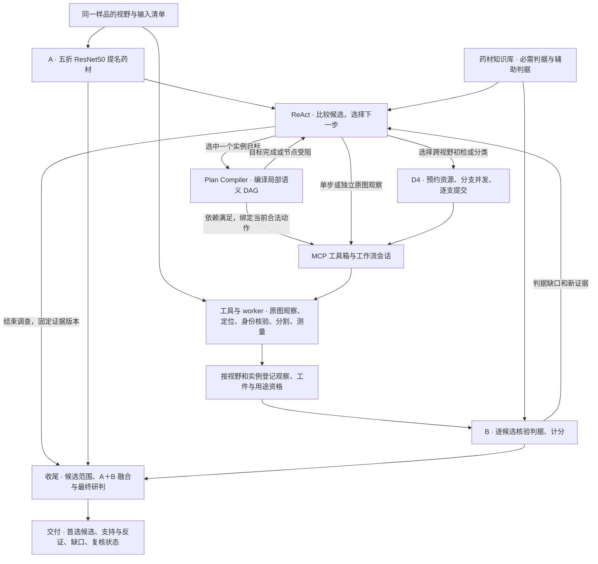

# TCM_Fusion 中药材显微图像鉴别

TCM_Fusion 接收**同一待鉴别样品的一张或多张显微图**。交付结果回答三个问题：最倾向哪种药材，哪些显微证据支持这个判断，还有什么需要复核。每条关键证据可以追回原始视野、实例及本次采用的工件版本。

**正式默认方案为 C＋D4，由 ReAct 主导调查。** 药材分类器提供候选先验（A），显微判据给出证据分（B）。在两者之间，ReAct 决定该查哪条候选差异；选定实例目标后，本地计划编译器把目标展开为依赖图（C）；不同视野有独立工作时，ReAct 还可以授权并发（D4）。调查顺序随证据改变，证据资格由程序核验。[正式运行模板](config/multi_view.json)

[架构与数据流](#架构与数据流) · [ReAct 的设计取舍](#react-的设计取舍) · [计划编译与语义 DAG](#计划编译与语义-dag) · [候选调查与证据控制](#候选调查与证据控制) · [并发与回交](#调查执行) · [计分与交付](#计分与交付) · [部署](#部署准备) · [运行](#运行一次鉴别) · [查看结果](#查看结果)

## 架构与数据流

以“这一束细长结构能否支持龙胆”为例。A 可以提名龙胆，视觉工具可以找到细长目标。要引用这个目标，仍要回答它究竟是针晶还是纤维、判据要求形态还是尺寸，以及这条观察对竞争候选是否同样成立。系统围绕这些问题反复调查，直到证据足以交付、需要人工复核或达到运行限制。



| 谁负责 | 它能决定什么 |
| --- | --- |
| 应用入口与 A | 核验图像清单和摘要，为一个样品建立独立运行。每个视野各取五折模型的逐折 Top-3，再合并候选；只在某一折出现的候选也有机会被查证。盲测参考标签留在事后核对环节。[应用层](lib/application/README.md) · [候选生成](lib/decision/candidate_policy.py) |
| Agent | 读取当前判据缺口、可用实例和预算，选择观察、测量、换路线或请求复核，并留下简短理由。候选的提出、暂停和恢复是调查状态，显微证据由工具取得。[规划与反馈](lib/agent/README.md) |
| MCP、工作流与 worker | MCP 将工具调用绑定到本次样品。每个工具在注册表声明所需技能、参数、权限和前置条件。工作流核对目标、依赖、额度和截止时间，worker 执行获准的视觉或测量任务。并发分支分别准备工件，由协调者逐支发布。[MCP](lib/mcp/README.md) · [工具注册表](lib/tools/tool_registry.py) · [工作流](lib/workflow/README.md) |
| 证据、判据与交付 | 证据层记录对象、来源、版本和用途。决策层按药材知识库核验判据，给出 B 分；应用层在收尾时组合 A、B 并生成报告。最终解释引用冻结证据，引用无效或文本研判失败时由程序生成可追溯的交付。[药材判据库](Agent判药/data/herb_criteria.json) · [证据层](lib/evidence/README.md) · [最终研判](lib/decision/final_assessment.py) |

## ReAct 的设计取舍

显微调查有两种不同的不确定性。看图前，没人知道下一张图会出现哪种结构，也就难以预定整例调查顺序。但在某个实例上，一旦选定“测量宽度”，身份、掩码、标定和测量之间的依赖是已知的。项目把前一种选择留给 ReAct，把后一种依赖交给程序处理。优化的是反复询问模型、重复看图和等待无关分支的开销，同时保留竞争候选改变调查方向的机会。

| 方案借鉴的思想 | 本项目如何采用 |
| --- | --- |
| **LLMCompiler · 分开规划、调度与执行** | 模型选调查目标。主机编译单实例依赖图，等前一步产生真实工件才绑定下一动作。可预见的局部工作能连续推进，遇到需要改变调查含义的问题就交回模型。[语义执行器](lib/agent/semantic_execution.py) |
| **ReWOO · 让推理引用已经取得的证据** | 同一物理观察在规划上下文里保留一份事实，各候选分别引用并解释。模型每轮看到紧凑的当前状态、判据缺口和合法菜单，需要细节时读取完整账本。这样可以少发重复描述，也能在视觉结果偏离预期时立即调整路线。[候选区分问题](lib/decision/comparison_problems.py) · [规划上下文](lib/agent/planning_context.py) |
| **Reflexion · 用执行反馈修订策略** | 本地控制器把失败或停滞绑定到具体问题。模型在下一次正常规划中可以采纳、维持、推迟或拒绝建议；采纳时说明要改变的条件和预期收益。后续用工件、合格证据和缺口变化核对实际效果。反思只作用于本次调查策略。[反思实施说明](融合链路文档/20_判据分值解释与反思策略增量方案.md) |
| **BATS · 把预算和未完成状态带入决策** | 推荐取证路线时计入后续分类、分割、测量可能消耗的资源。派发前检查及预约额度，为最终研判留时间。便宜的原图观察能回答存在性，却不能替代一个定量判据所需的测量。预算不足时，已完成工作和仍不可核验的缺口一起交付。[调查成本估计](lib/decision/candidate_audit.py) · [资源账本](lib/runtime/resource_budget.py) |

正式入口运行一个 ReAct 调查循环。计划编译、证据投影、预算校验和反馈评估由本地程序完成，模型在下一次必要规划中同时选择行动和回应反思。[方法来源与采用边界](docs/方国昊/最终优化计划_v1.1_评估修订稿.md) · [实施与配对验收](融合链路文档/10_ReAct主导的证据优化与语义DAG实施部署方案.md)

## 计划编译与语义 DAG

**以“测量视野一中某个已定位实例的宽度”为例。** ReAct 从当轮菜单选择实例目标，同时说明它要回答的判据问题。当前目标有四类：核验身份、测长度、测宽度、测面积。程序可据此检查模型究竟授权了哪一个实例、哪一种结果。[目标选择协议](lib/agent/planning_choices.py)

1. **编译目标。** Plan Compiler 把“测宽度”展开成局部有向无环图（DAG）：**核验身份 → 取得掩码 → 核验宽度用途及标定 → 取得宽度 → 重算判据**。节点记录依赖、所需事实和何时失效。“核验身份”单独成图时只含第一个节点，执行器不会自行把目标扩大到测量。[目标编译](lib/agent/semantic_execution.py)
2. **运行时绑定。** 实例账本用原图及其坐标识别目标。轮到某节点时，主机重新读取有效工件与合法工具。已有合格身份或已有所需宽度可直接满足相应节点；需要分割时才派发分割，成功后才引用实际生成的掩码。换一个裁图文件名不会凭空多出一个实例，高度重叠但身份有歧义的框也不会被自动合并。[实例账本](lib/evidence/instance_ledger.py) · [工具契约](lib/tools/tool_registry.py)
3. **按结果回交。** 宽度取得后重算判据，ReAct 再决定该比较哪种药材。如果分类发现它是另一类结构、轮廓需复核、标定失效或绑定输入已变，执行器记录受阻原因，停止未执行的后继。模型可以换实例、换视野或提交复核。单个实例目标完成只解决本次局部问题。[执行与回交](lib/agent/react_graph.py)

当前落地的是**单实例串行语义 DAG，加上 D4 有限跨视野并发**。另一个视野可能先产生结果，怎样交回模型取决于该结果的调查价值。整例的候选、未来裁图和工具顺序在调查中逐步确定。10 号方案总体图中的通用事件总线，以及任意子图收齐指定数量的结果就触发后继（quorum），仍属扩展设计。[DAG 的设计边界](融合链路文档/09_DAG与旧短计划边界.md) · [D4 运行时](lib/agent/physical_execution.py)

## 候选调查与证据控制

### 用反例辨认容易看错的结构

以针晶为例，如果只告诉模型“寻找细长、尖锐的结构”，一束纤维也可能符合描述。项目为容易混淆的特征配了**有具体形态理由的反例**。查针晶时，提示同时保留“可散在，也可成束密集”的正例，并提醒观察细长结构有没有连续的细胞壁和胞腔，或有没有导管的环纹、网纹。这样，模型有理由重新检查疑似纤维的框，也有理由保留紧邻成束的真针晶。反例随当前调查目标切换：查纤维时，同样的细胞壁和胞腔就成为辨认纤维的线索。[特征描述配置](config/multi_view.json) · [反例选择依据](config/negative_feature_bank.json)

反例的选择来自检测错误分析。针对针晶，纤维等易混组织是重点对照，簇晶、方晶和花粉粒只作辅助对照。淀粉粒在这次分析中更突出的问题是漏检和标注粒度，把它列为主要负例反而偏离了要解决的问题。对需要目检的裁图，Agent 还可调用**图像示例审计**，把待查目标、同类正例和易混反例放在同一张图上，让模型比较可见形态并说明理由。这条意见供复核使用。要形成针对某种药材的反证，还需落实到该候选的正式判据，例如身份和标定均合格的实例，其实测尺寸落在该候选参考范围之外。[示例审计](lib/vision/image_exemplar_audit.py) · [证据采信规则](lib/evidence/evidence_projection.py)

### 让竞争候选参与决定下一步查什么

每轮先让所有活动候选与已有证据对照，再决定下一次观察是否值得付出成本。推荐动作优先考虑能区分候选的判据、从当前实例能否走到合格结果、还需多少调用，以及一次调查能服务哪些候选。某个候选的必需项尚未满足时，系统暂不为它单独推荐只补辅助项的动作；其缺口继续对 Agent 可见，同一动作若能解决另一候选的必需项，仍可选用。推荐顺序给 Agent 取舍，工具资格和预算由主机执行。[候选审查与推荐](lib/decision/candidate_audit.py) · [规划菜单](lib/agent/planning_choices.py)

例如，两个候选都要求观察导管，同一视野只需回答一次“这里能否看见导管”。看图模型收到的是特征描述，候选药材名留在规划层，减少预期答案对观察的引导。找到导管后，Agent 再比较两者对形态或直径的要求。如果同一条观察对两者都成立，它可以被双方引用，却仍解释不了为什么其中一个应排在前面。这时，**查一项能区分两者的判据**，通常比再找一个相似的导管更有价值。[候选比较设计](lib/decision/comparison_problems.py)

### 把证据能说明的范围保留下来

项目按样品综合多视野，按视野和实例限定每条观察能回答的问题。YOLO 初检或定向补扫可以产生裁图；裁图 CNN 支持批量初判，低置信或待定实例可再由 Agent 选择单体复核。原图中合格的定性观察可以支持相应存在性判据，疑似框可以引导定位。要回答“这个实例的直径是否符合判据”，则要有匹配的身份、适合该用途的分割轮廓、同一视野的可信比例尺和实际测量值。上游工件被替换后，依赖旧版本的尺寸失效。[视觉工具](lib/vision/README.md) · [实例账本](lib/evidence/instance_ledger.py) · [证据版本](lib/evidence/evidence_store.py)

因此，“未查”“本视野未见”“调用失败”和“有合格反证”分别记录。例如，视野一未见纤维，视野二仍可继续寻找。某个已确认实例的合格尺寸落在候选的参考范围外，才构成针对该候选这条尺寸判据的反证。收尾时的特征审计读取当前有效的初检、补扫、批量分类等工件，供人工目检；审计意见本身没有给 B 加分的权限。[证据采信](lib/evidence/evidence_projection.py) · [特征审计](lib/vision/feature_audit.py)

规划和收尾共用同一份**证据资格投影**。它为每个候选标出可引用的支持、合格反证、仅供调查的线索和未解项。一个视野新增无关工件，不会改变已有事实的引用 ID。待核验分类可以进入暂定分析，正式 B 分只读取符合相应用途的证据。这使规划器提出的理由和最终报告可用同一出处核对。[证据资格投影](lib/evidence/evidence_projection.py) · [暂定证据](lib/evidence/provisional_evidence.py)

### 用下一步取得的证据评价反思

一次工具执行成功，可能只是多了一个裁图，也可能真正解决了一条判据。系统分别记录动作是否成功、是否解锁后继，以及证据或裁决发生了什么变化。例如，连续处理边界不清的目标仍得不到可用尺寸，Agent 可以选择换视野。下一轮用实际产生的合格测量和判据变化检查这条建议是否奏效。持续没有进展时，可以带着未解问题请求复核。这使复核者能从同一条轨迹追到“建议了什么、实际做了什么、得到了什么”。[任务内反思](lib/agent/reflection_controller.py) · [动作反馈](lib/agent/action_feedback.py)

这里有两项细粒度控制。首先，按实例、输入和方法识别**同一次尝试**，无变化的重复请求受到限制，换视野、改变方法或取得有效修复输入后可以重新调查。其次，复核是合法出口。如果模型想结束而证据尚不足以确认，系统可直接交付复核；收到停止建议后连续两次继续且仍无进展，也会保留现有证据并收尾。操作终止原因和药材能否确认分别进入报告。[调查控制](lib/agent/investigation_control.py) · [停止与复核](融合链路文档/13_调查建议与硬约束分离.md)

## 调查执行

ReAct 保留每次调查方向的选择权。**C 处理同一实例内的前后依赖，D4 处理不同视野间的独立工作。** 项目把两者放在同一个规划菜单里，单图和多图共用这套入口。[调查主循环](lib/agent/react_graph.py) · [正式参数](config/multi_view.json)

| Agent 的选择 | 如何执行，何时交回规划 |
| --- | --- |
| 单步调查 | 只选一次原图观察、初检、补扫或实例操作。若第二个视野只是第一个失败后的备选，等第一步出结果后再决定是否动用它。 |
| C · 同一实例的语义目标 | 一次授权完成选定目标。每个实际工具仍独立检查资格和额度，目标完成或受阻时回交规划。[计划编译与语义 DAG](#计划编译与语义-dag) |
| D4 · 跨视野物理并发 | Agent 可显式选择 2～4 个不同视野，用同一种工具做初检，或各取一张裁图做单实例分类。选择时逐路考虑“即使其余分支都得到理想结果，这一路是否仍值得做”。主机检查独立性、依赖、额度和剩余步数，并逐支提交有效结果。[并发调度](lib/workflow/physical_schedule.py) |
| 成组原图观察 | 两个可独立回答的原图问题也可以一起发出。这类观察等两份结果汇合后再进入下一轮规划。[规划选择](lib/agent/planning_choices.py) · [观察执行](lib/agent/react_graph.py) |

**D4 的第一个分支完成时，会立即唤醒规划吗？** 结果要先被主机接纳，并且解锁新的实例操作、解决判据、新增合格反证或改变规则判定。此时若还有分支在运行、还有规划步数，就能提前交回（`physical_partial`）。例如，视野一先检出可分类裁图时，Agent 可以选择对它做单实例分类，视野二继续初检。其他有依赖的动作等本组汇合后重新核对。普通完成回执可以一起处理，收齐时记录 `physical_join`。[分支结果收集](lib/agent/react_graph.py) · [并发执行器](lib/agent/physical_execution.py)

**怎样避免快慢分支相互污染？** 派发时固定每支实际读取的工件、允许写入的视野范围与预算预约。worker 在私有目录准备结果，由一个协调者核对依赖后发布。重复回执只生效一次，任务关闭后迟到的结果不会改写最终证据；远端是否已经计费无法确定时，资源账本记为未知。[并发提交与对账](lib/workflow/physical_schedule.py)

龙胆五图实跑提供了一个取舍实例。Agent 自主选择四视野并发初检，随后核验实例和竞争判据。它取得龙胆的针晶与表皮细胞支持，还得到一条针对桔梗的尺寸反证：分泌组织宽度为 5.12 μm，低于桔梗 14–25 μm 的参考范围。同图单开 C 和 C＋D4 各成功运行一次，分别用了 34 和 44 次规划、1,280.14 和 1,768.71 秒。这组记录能说明额外调查换回了什么，也说明默认开放并发并不保证每例更快。[龙胆五图配对实测](运行结果/测试运行总报告.md#archive-case-35)

## 计分与交付

| 阶段 | 判定依据 |
| --- | --- |
| B 规则分 | 先核验每个候选的必需判据（required），再计独立辅助判据（supporting）。按 **80∶20** 分配基础分与佐证加分，全部必需项合格才开放加分。部分达成只能取得对应基础分，完全没有合格必需证据时 B 为零。同一辅助特征在多个视野出现只取最高合格贡献，已用于必需项的特征也只计一次。[正式评分](lib/decision/rule_scoring.py) |
| 融合排序 | 默认 `融合分 = 0.5 × A 先验 + 0.5 × B 规则分`。A 先验在所有视野、所有折上取平均，一折榜单未提名该候选时该折计零。B 排名、融合计算和最终报告共用 `rule_score`。`raw_score` 仅保留供审计，融合分用于比较候选；报告不将它解释为正确率。[融合计算](lib/decision/ab_fusion.py) |
| 正式交付 | 核对必需项、独立特征数、领先分差和证据出处。默认要求两类独立特征，单类强证据即使条件放行也要复核。若融合改换首位，原首位的正式结论不能转给新候选。A 名单外的候选须满足全部必需和辅助项，且至少一项必需特征具有特异性，才可进入当前的开放式候选范围。证据只到药材组时，交付保留组级结论。[候选范围](lib/decision/candidate_scope.py) · [最终研判](lib/decision/final_assessment.py) |

**为什么“支持判据数为 2”不等于加 0.2？** 支持数衡量有几类独立特征获得合格支持，包含必需项。用于加分的只有其中独立的辅助项。设 `R` 为扣除反证并应用上限后的必需项达成度，`E` 为各独立辅助特征的合格贡献之和。基础分为 `0.8 × R`。全部必需项满足时，再加 `0.2 × R × E / (1 + E)`。这样，在必需证据相同的两个候选之间，额外的独立佐证能拉开分差，重复观察同一特征不会不断抬高得分。[计分实现](lib/decision/rule_scoring.py)

以**龙胆五图的冻结证据**为例，针晶满足龙胆的必需项，`R = 0.60`；表皮细胞提供一类独立佐证，`E = 0.255`。两类支持使龙胆得到 `0.480000 + 0.024382 = 0.504382`，知母和射干各得 `0.480000`。龙胆在 B 分上领先，但领先幅度低于明确区分所需的 0.10，仍需复核。这是同一批证据按现行规则的离线复算，可解释计分变化；最新调查策略的耗时和 token 收益仍待实测。[龙胆逐项计分](运行结果/评估__B规则__30用例__20261119-095522__佐证计分/README.md) · [五图实跑摘要](运行结果/测试运行总报告.md#archive-case-35)

## 部署准备

命令从本目录运行。仓内的 Plan A、YOLO、Stage2、原分割与测量组件由 [paths.py](paths.py) 定位。搬迁后重新登记三个本地环境。安装方法、模型摘要和远端服务配置见 [独立部署](独立部署.md)。

## 运行一次鉴别

### 1. 准备输入清单

把同一样品的待测图片放在一个目录内。至少选择一张，按预期顺序列出每张图的文件名和 SHA256。路径须在输入目录内，路径和图像内容各自唯一。盲测时使用中性目录及文件名，参考答案保留在独立的结果核对记录中。

在新的输入目录中，可用以下命令生成单图清单。多图只需在 `$views` 中按顺序追加文件名。

```powershell
$source = 'D:\tcm-input\S01'
$views = @('view01.jpg')
$manifest = @{
    views = @(
        foreach ($view in $views) {
            $image = Join-Path $source $view
            @{ view = $view; sha256 = (Get-FileHash -LiteralPath $image -Algorithm SHA256).Hash.ToLowerInvariant() }
        }
    )
}
[System.IO.File]::WriteAllText(
    (Join-Path $source 'input_proof.json'),
    ($manifest | ConvertTo-Json -Depth 4)
)
```

入口默认读取输入目录中的 `input_proof.json`。已有独立清单时，在预检和实跑命令上都传入 `--manifest` 指定其位置。

### 2. 预检并实跑

默认使用仓内视觉环境运行 Plan A，也可显式指定兼容解释器。使用相同参数先做预检，再创建一次独立的真实运行。预检会校验图片、准备任务配置并写出本地就绪报告。真实运行会按所选动作调用视觉服务，可能产生 API 费用。

```powershell
$python = '.\.venv\Scripts\python.exe'
$aPython = '.\.venv\vision\Scripts\python.exe'
$runArgs = @(
    '-X', 'utf8', '-m', 'TCM_Fusion.cli.main', 'multi-view'
    '--source-dir', $source, '--a-python', $aPython
    '--subject', 'S01', '--purpose', '显微鉴别', '--json'
)

& $python @runArgs --dry-run
if ($LASTEXITCODE -ne 0) { throw '预检失败，请查看 doctor.json 或终端错误' }

& $python @runArgs
```

每次调用独立创建 case 目录并生成中性图像副本。默认输出到 `运行结果/`，用 `--output-root` 可另指定落点。目录名含运行类型、对象、图数、开始时间、目的及去重短 ID。预检的 JSON `directory` 指向 case 根，真实运行的 `directory` 指向正式工件目录 `runs/fusion_<id>/`。[运行目录命名与索引](运行结果/README.md)

## 查看结果

| 要确认的问题 | 从哪里看 |
| --- | --- |
| 输入是否准备好，任务是否完成 | case 根的 `input_proof.json`、`doctor.json`、`interface_status.json`。完成后用 `run_location.json` 定位正式工件。 |
| 最终判了什么，是否需要复核 | `output.json` 中的 `status`、`top_candidate`、`review_required`，以及供人工阅读的 `report.md`。 |
| 结论依据与缺口是什么 | `final_assessment.json` 记录候选比较、复核原因和终止原因。用 `final_evidence.json` 追到对应证据和资格。 |
| 同一个候选的 B 分和融合分是怎样得到的 | 在 `agent_verdict.json` 的 `ranking` 找到候选 ID，对照 `score_components` 中的必需基础分与独立佐证加分，再看 `rule_score`、`a_probability` 和 `fused_score`。 |
| 为什么选了这个动作，另一条路线当时可选吗 | `agent_trace.json` 中的 `planner_offer` 留下实际提供的菜单，`thought` 留下所选动作及简短理由。结合后续动作反馈看它是否解决了原问题。 |
| 实例目标执行到哪一步，并发有无提前交回 | 选过语义目标时，`workflow/semantic_plan.json` 记录最近目标的节点状态和结束原因。按时间查看 `agent_trace.json` 的执行事件，`physical_partial` 表示部分结果触发规划，`physical_join` 表示该组收齐。 |
| 哪个计算阶段失败，耗时花在何处 | `workflow/operations.json` 查看阶段终态，`workflow/action_timeline.json` 查看时间线，`workflow/ops/` 查独立 worker 工件。网络请求已预留但关闭任务时还没有回执，资源账本 `workflow/resources.json` 会以 `unknown` 收尾。 |
| 候选为何被暂停，换路线有没有效果 | 有假设更新时看 `workflow/investigation.json`。在 `workflow/reflection_controller.json` 中分别核对反思建议、实际采纳的策略及后续动作效果。 |
| 哪一版裁图或掩码参与了裁决 | 用 `final_evidence.json` 的 `evidence_version` 定位 `workflow/evidence/versions/<版本>.json`，按工件 ID、父依赖和摘要回查对应文件。 |
| 如何目检裁图和 mask | `feature_audit/feature_audit.json` 按有效证据版本登记裁图、分类和 mask。正式采信以最终证据和研判工件为准。 |

### 实例：为什么白芍排第一，Agent 仍请求复核

2026-11-18 14:04:22 的白芍单图开启了实例语义执行。归档摘要记录了 1 次初检、3 次身份分类、3 次分割和 2 次测量。白芍的 1 项必需判据获得支持，3 项辅助判据中有 1 项仅在本视野未见、2 项未查。Agent 请求复核，最终交付“暂定白芍”。即便有两次测量，独立证据广度仍只有一类。该次运行保留逐案摘要；核对新任务的逐步调用与版本可使用上表中的工件。[白芍单图运行摘要](运行结果/测试运行总报告.md#archive-case-23)

## 源码与文档

| 想追踪的内容 | 入口 |
| --- | --- |
| 从 CLI 到任务收尾 | [主入口](cli/main.py) · [应用层](lib/application/README.md) |
| Agent 怎么选动作，工具怎样受控执行 | [Agent](lib/agent/README.md) · [MCP](lib/mcp/README.md) · [工具](lib/tools/README.md) · [工作流](lib/workflow/README.md) |
| 工件如何入账，证据怎么进入裁决 | [证据](lib/evidence/README.md) · [决策](lib/decision/README.md) |
| 从样品准备到运行定位 | [单图手册](单图测试操作手册.md) · [多视图方案](多图测试运行方案.md) |
| 配置、回归与其余组件 | [配置导航](config/README.md) · [测试导航](tests/README.md) · [源码导航](lib/README.md) · [设计文档索引](融合链路文档/00_INDEX.md) |

本地回归与录制工件回放分别从以下入口进入。

```powershell
& $python -X utf8 -m TCM_Fusion.cli.main selftest
& $python -X utf8 -m TCM_Fusion.cli.offline workflow-replay --help
```
