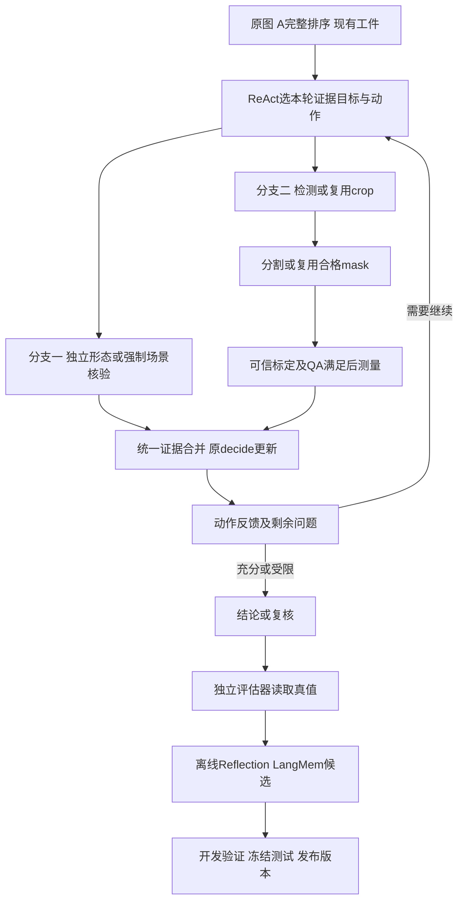

# 带真值反馈、并发取证的ReAct与Reflection优化方案

版本2.0｜2026-11-03｜历史候选方案。

2026-11-04 实施对照：逐折 Top-K（默认每折 3）、adaptive_v2 短动作编号、有界工具调用及任务内反思卡已落地。离线 LangMem 由显式命令验证与发布；运行时不读取答案。串并发和真实收益仍按独立对照评价。现役执行见[决策协议](融合链路文档/05_决策协议.md)。

原提案：继承v1证据/权限/裁决/版本约束，按用户意见调整：本地诊断工具后置；动作收益和有真值的Reflection优先；保留mask→测量，与独立视觉核验并发，不用丢弃物理链换取贯通。

## 1. 标准答案如何用于自我优化

可以用真实标签判断Agent是否纠错，并据轨迹优化策略。当前优先采用“有监督的策略/提示改进”，沿用LangMem，不训练VLM权重、不引入RL。输入数据分为两个逻辑区：Agent可见的图像、A输出和合法证据；评估器专用的reference_label、sample_group、split、label_source。运行结束再把真值和轨迹交给离线反思，不让部署策略在执行中看到本题答案。

若希望有答案时反复练习，也可在training内迭代，但重复尝试和成本必须合并记账；开发/冻结测试只按固定策略执行，不看答案修正后再计首次正确。模型输出、文件夹名、人工类别标签都不能直接变成检测/测量证据。

首先确认标签对应的是图像类别还是完整物理样品鉴别。图像来自淫羊藿不等于单视野具备原B全部鉴定判据。若规则因缺证据拒绝正确类别，Reflection可学习补证据或请求复核，不能修改证据让规则迎合标签。知识库错误需要单独人工审计。

## 2. 相对v1的调整

| v1方向 | v2处理 |
|---|---|
| 本地诊断优先 | 先不新增工具，使用已有status/error_code/坐标/来源/工件状态；不足时才补诊断 |
| 去掉测量总门 | 改为逐工具依赖和并发取证；严格保留mask、标定、测量质量门 |
| 新动作收益 | 保留并优先实施，分中间进展与最终真值效果 |
| Reflection | 增加正确/错误/复核的真值反馈，失败与成功轨迹共同学习 |
| 对照验收 | 增加串行/并发及无反思/有反思消融 |

中心点质量规则的形状盲区不会因Agent策略改好而消失。其原始失败状态继续保留，不把诊断工具后置解释为取消现有QA/来源校验。当前diagnostic_review仍只用于联调。

## 3. 并发架构：保留两条证据路径

同一crop的分割→测量有硬依赖，不能同时起跑。可并发的是“独立形态核验”和“分割→测量”两支，或不同crop；只有确有必要且预算允许时分叉，不固定每张图都运行两支。强制场景条件必须先完成，不能被并发绕过。

单支失败不取消另一支；形态结果只能提供合法存在性/场景证据，不能补尺寸。mask失败保留失败记录，不认定特征不存在，也不让测量绕门。最终输出记录各支完成、失败、未启动或未等待状态；需要尺寸的判据未满足时继续复核。

每个返回结果触发一次可串行提交的证据更新，不必等全部请求完成才思考。若另一支使旧动作不再必要，取消尚未提交的请求；在途请求不保证可退费或远端已取消。最终截止后到达的结果只审计，不悄悄改变已经发布的结论。

## 4. 并发工程：不是把现有函数直接gather

当前ToolSpec、预算锁、证据CAS可复用，但需要核对锁范围。账本应在短锁内预约/去重，释放锁后发网络请求，返回后短锁写结果；不能持全局锁等待HTTP。相同幂等键只允许一个执行者，pending有owner/状态，崩溃不盲重发；不是到期就认为上次没执行。

不同分支携带各自依赖哈希。提交时由单一合并器做CAS：相关crop/标定/mask变化则结果过期；仅无关分支增加证据时可复验依赖后重基提交，不能因全局版本号变动误丢有效结果。共享预算原子预约，各池仍独立受限。

初始并发上限建议2，属于待验证的工程起点。规划、看图、worker均须按剩余时间设置整次请求硬截止，隔离进程可终止；MCP/socket超时只作第二层。并发不是更多重试，服务404等已知不可修复错误继续熔断。

## 5. 动作收益：用它支撑反思，但不把代理分数当正确率

拟新增action_feedback记录（尚未实现）：action_id、branch_id、dependency_hashes、objective、accepted、new_features、new_counterevidence、resolved_criteria、remaining_criteria、unlocked_capabilities、candidate_changes、cache_hit、api_attempts、latency_ms、failure_code、next_options。

中间反馈只用程序能验证的信号：修复一个实际前置阻塞、取得新的有效证据/反证、解决候选判据差异、重复请求、无效读取、失败或超时。文件哈希变化本身不给正收益；合法反证无需提高第一候选分数也可有价值。规则分数不是概率，不计算其熵作为已验证信息增益。

任务结束由评估器增加：A是否正确、最终是否正确、是否把A错纠正、是否把A对改错、是否复核、真实总请求和耗时。先保留多目标向量，不预设一个随意加权总分：优先避免新增误判，再比较纠错/正确覆盖、复核及成本。未知标签样本只能评价流程，不能提供正确性奖励。

中间收益不能独立证明某动作导致纠错。归因需看分支前后有效证据变化，必要时在相同工件下做移除某动作的回放。多个动作共同生效时保留联合归因，不编造标准答案的唯一推导路径。

## 6. Reflection怎样利用错误答案

终局反馈示例：A=广藿香、参考=淫羊藿、Agent=证据不足。评估为“未纠错且选择复核”，不能当误判已纠正，也不能把复核等同错误确定结论。若轨迹只反复分割同一区域、从未查候选差异，可形成“在该条件优先独立形态核验”的策略候选；若类别变化而证据不足，只能记类别冲突待核验，不能直接写“应识别为非腺毛”。

反思产物四部分：可复核事实、失败原因假设、适用条件、建议策略及验证需求。任务内可用失败码和动作反馈生成轻量策略调整，不看隐藏真值；跨任务离线反思可读取训练真值及成功/失败对照轨迹，提炼动作排序、并发条件、缓存和停止策略。

复用现有LangMem优化入口，但当前白名单信号不足，需要扩展为上述结构化反馈及终局评价，绑定轨迹摘要、样品分组和策略版本。避免输出记忆“本题答案”；默认不传原图、可识别文件名和模型内部推理，传工具事实和必要的候选关系。旧reflection.py的simulation阈值试验保留，不混作真实策略学习。

候选不能改工具权限、物理证据、判据、QA阈值、预算或最终decide。开发集验证后才发布，冻结测试不参与提示优化。录制回放缺失的新动作不得伪造观察；需要新视觉分支时，显式列出新增API需求再预算执行。

## 7. 实施顺序与测试

阶段一，1～2人日：定义终局真值评估和动作反馈，替换哈希即收益；给现有轨迹生成反馈，零新图片API。验证错转对、对转错、复核、反证、重复动作分别记账。

阶段二，2～3人日：逐工具前置条件、两分支调度、短锁预约、CAS合并和硬截止。用受控服务测试真实并发、重复键只执行一次、两个任务抢预算、无关版本可合并、相关父工件变化拒绝、服务失败不阻断独立分支。严格模式mask不过关仍不得测量。

阶段三，1～2人日：扩展LangMem训练反馈，加入有条件的策略候选及回滚；先回放，再按预算做真实新分支验证。确认反思不能修改证据/判据、测试集不能训练、未知观察拒绝、策略版本与缓存身份绑定。

阶段四，1～2人日：冻结同一批样品，对照原B固定流程、串行ReAct、并发ReAct、并发ReAct+Reflection。各组统一预算/模型/初始工件，分别报告冷启动与复用。按物理样品分组，核查A训练重叠；同一样品视野不得跨训练/测试。报告配对变化和不确定区间，不能以单张图反复成功当泛化。

核心指标：A错样本纠错率、A对样本被改错率、总体正确率、复核率、输出结论时的正确率、cost per correct case、规划及视觉总请求、p50/p95时延。训练小样本阶段先做工程验收；业务阈值和非劣界待确认。总体估计5～9人日，不含采集真值、模型推理服务等待及大规模评估。

## 8. 文件改动映射与本轮边界

| 现有文件 | 拟改内容 |
|---|---|
| lib/react_graph.py | 分支调度、每次动作反馈、事件驱动再规划、停止理由 |
| lib/workflow_runtime.py / workflow_session.py | 严格模式逐工具依赖、工件分支合并、mask/测量保留 |
| lib/agent_tools.py / ledger_lock.py / resource_budget.py | 短锁预约、同键单执行、并发预算、真实成本记录 |
| lib/mcp_bridge.py / controlled_process.py | 请求硬截止、取消和返回状态 |
| lib/prompt_optimization.py / reflection.py | 带真值终局反馈、结构化反思及版本验证；旧模拟边界保留 |
| 新增action_feedback / evaluation模块 | 中间进展与独立真值评估分离，接口待实现 |
| tests及现有selftest | 反馈、并发、回放、权限不变量和真实流程断言 |

本地诊断工具暂不列入首批。现有schema、配置、工件QA守卫不能删除。暂不新增框架依赖，优先复用LangGraph/MCP/LangMem。此文只调整候选方案，未修改业务代码、未发API，不能宣称并发/反思已生效。

待提供或确认：训练/开发/冻结测试样品及真值来源（是否样品级鉴别真值）；首批真实回放API预算与最大等待时间；策略候选是否进入正式发布。前两项缺失仍可完成离线实现，真实收益结论须等待有效验证。

变更记录：2.0 | 2026-11-03 | 采纳真值反馈、并发保留物理链、本地诊断后置，明确反馈归因与发布验收。
