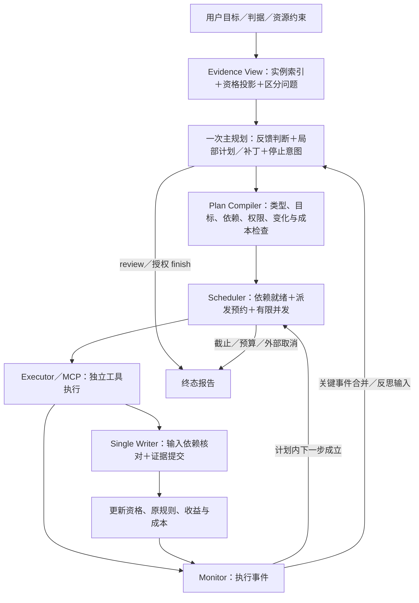

# 最终优化计划 v1.1（评估修订稿）

日期：2026-11-17。状态：**设计审阅稿，尚未实施；不替代当前运行配置、项目规范或原规则引擎。**

修订依据：用户提供的《最终优化计划 v1.0》、当前 `TCM_Fusion` 源码，以及文末四篇论文的相关方法章节。保留原稿十节结构与主线；**加粗条款标出关键修订**。新增结构和字段均为拟议契约，不是现有接口声明。原始附件保持不变。

## 评估结论与必须修正的条款

v1.0 已把实例共享、候选区分问题、提前证据校验、局部图执行、反思补丁和单写者串成完整方向，值得保留。实施前需要修正以下边界，否则会产生新的阻塞或重复请求。

| v1.0 条款 | 问题 | v1.1 修订 |
|---|---|---|
| 全局停止由 LLM 决定 | 缺少截止、取消、预算耗尽和服务终态 | 自主停止意图归 LLM；硬执行终止归运行时，终止后仍生成报告 |
| 只有 delivery 满足才允许 final | 若 delivery 指正式鉴定，会挡住 review/受阻报告 | 所有终态都交付报告；仅正式结论需要对应证据授权 |
| 不能取消竞争候选分支 | 与始终允许 review 冲突 | 不因 top1 满足自动取消；模型可以选择结束调查，未核验项保留未知 |
| all_of 仅用于最终汇总 | 测量本身可能需要多个共同前置条件 | 依赖就绪规则与控制器唤醒规则分开；any_of 不替代完整数据依赖 |
| Compiler 为全图预约预算；预算位于 S4 | 未就绪节点可能占满额度；并发缺少基础约束 | S0 即有全局约束；编译期估算，派发时原子预约，HTTP 层按实际请求记账 |
| 语义节点优于具体调用 | 编译器可能暗中选择目标/方法 | 模型可给语义意图和具体工具约束；歧义不能默选第一个目标 |
| identity/mask/measurement 总状态 | 重回一张 mask 决定所有用途 | 用途资格按身份、形态、长度、宽度、面积分别评估 |
| supported/tool_missing/kb_gap | 工具缺失与输入缺失混同；kb_gap 不一定能给组结论 | 分开方法、前置条件、输入和知识库边界；仅输出知识库已有的组 |
| 引用绑定 evidence_version | 全局版本变化可能造成无关结果全量失效 | 引用稳定事实；执行有效性检查实际读取集合，正式发布按当前投影复核 |
| 反思后动作必须改变 | 容易激励无意义换动作或越权守卫 | 允许维持/停止；评估问题是否解决，补丁不得扩权 |
| 普通成功不唤醒、关键事件唤醒 | 缺少事件合并及旧规划返回处理 | 单次在途主规划、事件去重/合并、补丁应用前核对依据 |

**验证范围：本稿仅做源码与文献核对，未运行新业务测试或真实视觉 API。最近 CODE-184/185 的语法/导入检查不能替代当前版本全量回归。**

## 一、目标与边界

目标：减少同一实例重复注册、同一物理问题重复观察和无变化的失败重试；保留多视野、多个真实实例以及必要补测。Agent 选择调查与停止意图，运行时约束执行、资格和结论发布；反思产生可检验的策略调整。

保留：

- 药材 A 逐图五折各自 Top-K，默认每折 3 个；保留来源，不用平均榜替代 Agent 候选。
- YOLO 优先初检；GLM 存在性观察与合法定向补救保持各自边界。
- 比例尺归检测；物理量来自真实 mask 与测量程序；判据沿用既有唯一事实源与加载链。
- 原图/历史运行只读；新任务、新策略使用独立运行工件；模拟、诊断和正式证据隔离。
- 最终仍由原规则决定正式支持、组级边界和 D8/D8b；分数不是校准正确率。

不采用：整场调查预生成后无反馈地执行；默认多思考 Agent；worker 并发改证据头；未经验证自动发布跨任务经验；top1 required 满足便取消竞争调查。

**可以生成阶段性短 DAG，也可以给出具体注册工具调用。自主性体现在目标、参数、依赖和方向由模型选择，不取决于节点名称是否抽象。**

## 二、最终架构



三个平面：数据平面维护工件、实例关联和派生投影；控制平面维护调查问题、局部计划与停止意图；执行平面管理调度、预算、运行状态和提交。

**Controller、Planner、Reflection 是职责分解，默认合并为一次必要的主模型调用。** 不固定设置三轮模型串行。Monitor 先使用确定性规则；工具内部调用 VLM/IGM 的费用仍独立计账。

Evidence Store 是工件与来源的权威。Instance Ledger 是其上的实例/尝试索引，Eligibility Projection 是受信评估生成的派生视图，不能成为三份可独立改写的证据事实源。

## 三、权限边界

| 决策 | 谁提出/执行 | 运行时约束 |
|---|---|---|
| 调查目标、继续、暂停、恢复 | 主 Agent | 已登记候选、工具、真实输入与资源 |
| review | 主 Agent；无动作时运行时收尾 | 作为证据不足出口始终允许；不授予正式阳性 |
| finish 请求 | 主 Agent | 对请求的结论层级校验原判据及当前证据 |
| 取消竞争分支 | 主 Agent | 记录理由、未核验问题与取消后可交付层级 |
| 精确重复任务 | 运行时合并 | pending 共享已有任务；done 复用合格结果；失败按方法/状态处理 |
| 截止、额度耗尽、用户取消、不能继续的服务故障 | 运行时 | 停止新派发，处理在途任务，记录真实终止原因 |
| 工件/用途资格、正式结论 | 受信程序与原规则 | 模型、skills、反思文本均不能覆盖 |

**LLM 拥有自主停止意图；Runtime 拥有执行边界和发布授权。硬终止不等待模型同意，不能伪装成模型主动复核。**

取消未完成候选调查不等于排除该候选。若剩余证据不足以正式区分，可交付组级或明确暂定/复核结果。规则已允许的单类条件放行不能被新控制层一律改成“两类支持”。

## 四、核心数据契约

本节为拟新增/修订字段。跨阶段工件沿用根 `contracts.py`；计划/工具校验复用现有 JSON Schema 机制，不引入第二套路径或判据权威。涉及根契约改动时跑项目要求的全量回归。

### 1. InstanceLedger

实例身份绑定样品、原图 SHA、原图像素坐标及来源关系。crop 重命名或不同 ROI 包含同一目标，不自动创建新物理实例；无法可靠关联时保留候选关系，不强行合并。`parent_instance` 要注明是同目标派生还是目标的部件，不能仅凭父子关系推断同一实例。

建议内容：

| 字段组 | 要求 |
|---|---|
| 身份 | instance_id、sample_id、source_image_sha256、coordinate_frame、source_bbox、坐标映射引用 |
| 关联 | crop_versions、lineage、association_status、关联依据引用；拆分/合并保留历史 |
| 尝试 | classification_attempts、segmentation_attempts、measurement_attempts；每次有方法、输入指纹、状态与实际成本 |
| 产物 | 分类/mask/测量的 artifact_id 和 SHA，不复制一份可改写的原始事实 |
| 资格 | eligibility_assessment_ref，指向评估方法、策略版本和绑定工件 |

**资格必须按用途区分，不使用单一 measurement=available 代表所有量纲。**

结构示例（示意值，不是真实样本结果）：

```json
{
  "instance_id": "I1",
  "source_image_sha256": "0000000000000000000000000000000000000000000000000000000000000000",
  "coordinate_frame": "original_pixels",
  "source_bbox": [100, 200, 300, 500],
  "association_status": "pending",
  "crop_versions": [],
  "classification_attempts": [],
  "mask_versions": [],
  "measurements": [],
  "eligibility_assessment_ref": null
}
```

用途评估分别表达 identity、morphology、length、width、area 的 eligible/ineligible/unknown，附原因与绑定来源。标定缺失只阻断依赖物理标定的量纲；review mask 不能自动变成存在性阳性，能否支持局部宽度须由实际评估方法证明。

尝试 key：实例 ID＋用途/问题范围＋方法/模型/工具版本＋有效输入指纹＋规范化修复参数。**不得把候选名、文件名、绝对路径或整个全局证据版本当作物理问题身份。**

规则：CNN pending_review 保留一次首次 GLM 复核；不是“一张 crop 总共只能分类一次”。工程失败、有效不可辨认、类别 other 和未执行分开记。新 ROI 恢复端点等有效变化由受信程序核验；模型自由文本或提示词措辞改变不能自行证明可重试。

### 2. ComparisonProblem

保留五折候选并集及知识库内扩展入口；活动候选是可恢复的调查工作集，不是永久 Top-2 白名单。候选退出调查不删除既有证据，也不证明其不存在。

问题包含 problem_id、active_candidates、shared_questions、difference_questions、evidence_refs、expected_impact、legal_action_ids。每个 question 绑定 feature、属性/关系、量纲、观察范围及判据版本。共享 key 不带候选名称，但**不同形态属性、不同范围的问题不能因 feature 相同而强行合并**。

capability 按问题细分：

| 状态 | 含义与后续 |
|---|---|
| supported | 有工具和足够前置条件，可调查 |
| missing_prerequisite | 缺可信标定/身份/mask 等，列出可恢复步骤 |
| insufficient_input | 当前视野不完整/不清晰，可评估其他输入 |
| unsupported_tool | 当前没有可用方法；换视野不必然补上工具能力 |
| kb_indistinguishable | 既有知识库明确组内不可分；允许其已有组结论 |
| kb_incomplete | 判据缺口；不能据此编造一个新组 |
| budget_blocked | 当前资源不可完成，保留未核验状态 |

普通 fiber 身份不自动满足 crystal_fiber 的复合结构判据。甘草/苦参宽度范围存在重叠，获得宽度不保证完成区分；G3 枳壳/陈皮按当前知识库边界交付。

### 3. EvidenceEligibilityProjection

沿用实际原规则枚举：`confirmed / probable / group_level / insufficient_evidence`；不用 `insufficient` 替代接口值，也不遗漏组级结果。暂定输出、needs_review 和正式 verdict 分列。

投影内容：candidate_id、formal_support、formal_counter、diagnostic_only、invalid_dimensions、gaps、formal_verdict、allowed_specificity、needs_review、evidence_version、criteria_version、qualification_policy_version。

**引用采用稳定的 artifact/observation 身份、内容摘要及评估版本；不能用每次重建包时变化的列表序号作为长期引用。** candidate 与判据的支持/反证关系由受信评估生成，身份观察不自动升级为药材身份支持。

每次有效提交后更新投影，在下一次必要规划前可见；final_assessment 复用同一套资格逻辑。发布前基于当前快照复核引用。全局版本前进时，未变化的事实可保留，旧资格必须按其输入和策略是否变化决定是否失效。

### 4. StopDecision

保留 can_finish、can_review、recommended_exit、goal_states、blockers，并补 execution_can_continue、hard_stop_reason、requested_conclusion_level。blocker 必须说明实际可执行的恢复动作或能力缺口，不能把无法解决的未知永久作为继续命令。

`can_review=true` 表示合法的复核交付路径；任务已经关闭时不再派发新模型请求，由运行时完成终态报告。`can_finish` 校验对应层级的原证据规则，不等于工具全部做完，也不等于强制两个支持类别。

### 5. LocalPlan / PlanPatch（补充）

只有上述四项仍不足以安全调度，须增加最小计划契约：

- plan_id、plan_revision、problem_ids、节点集合、输入/输出类型、工具绑定、depends_on、run_if、反馈条件、失效条件、资源估计。
- 每个节点记录 read_set：实际读到的 artifact_id＋SHA/评估策略；未知输出使用有类型的 output_ref，物化后再次校验。
- 局部补丁记录 base_plan_revision、依据事件与 read_set、add/replace/cancel/reprioritize 操作。禁止环、未绑定引用、越过工具权限、任意表达式执行和删除历史证据。
- 编译器可解析确定的占位符，不能在多个具有不同调查意义的实例中默选第一个；返回需模型决策的候选绑定。预先由模型授权的确定性选择器可以执行。
- 引用未变化的独立节点继续使用；只有受影响的后继失效。补丁改变调查优先级不等于旧证据失效。

## 五、停止规则

### 1. 自主停止与硬终止分别记录

LLM 可选 continue、review、finish、cancel_branch。截止、预算耗尽、用户取消或服务不能继续时，运行时硬终止；记录 source、reason、剩余问题与恢复位置。

### 2. review 是合法交付路径

**所有终态都必须进入报告生成。证据不足不阻止报告，只限制报告中的结论层级。** 可以给出已授权的组级结果、暂定倾向和缺口；不凭 review 标签虚增或撤销正式支持。

### 3. finish 需要运行时授权

required、支持广度、组级边界、反证、用途资格与引用按既有规则核对；失败不能由模型声明覆盖。拒绝理由须随输入/证据状态变化更新；不能“一次拒绝后永远隐藏 finish”。相同状态下的无变化重复请求可抑制。

### 4. 竞争候选分支

top1 required 满足不是自动取消命令。**但模型可以选择停止进一步区分并交付 review；无需为了退出先把每个候选调查完。** 若要发布更具体的正式结论，须通过对应证据门，未核验竞争问题明确记录。

### 5. GOAL_SATISFIED 的三个范围

LOCAL_GOAL_SATISFIED、COMPARISON_GOAL_SATISFIED、DELIVERY_GOAL_SATISFIED 均绑定 scope、证据引用和评估版本。前两者提供控制信息；delivery 区分“正式结论授权已满足”和“复核/受阻报告材料已准备”。不能用前者阻止后者交付。

### 6. 自动合并与取消

精确重复的 pending 任务共享已有 future，done 复用合格产物。失败记录阻止无变化重发，但不阻止已验证的新输入/方法或预算内声明的合法重试。依赖失效、权限撤销、硬截止可由运行时自动撤销派发；这是执行保护，不是排除候选。

## 六、执行模型

### 1. 局部执行图与类型绑定

Controller 选择问题，模型输出局部意图/工具约束与依赖，Compiler 校验，Scheduler 执行。允许已有明确 target 的具体工具节点，也允许引用未来输出的节点；**语义层不能掩盖工具、参数和 API 调用**。每个实际调用仍逐条审计。

当前已有 ToolSpec/input_schema/result_guard，但部分输出仅为 object。实施前补足实际输出类型/工件引用规则，避免“合法 JSON”被误认为“合法 mask/测量”。真实前置条件在派发和提交时复核，不能只在编译时验证。

### 2. 分开依赖就绪与反馈触发

| 机制 | 用途 | 不允许替代什么 |
|---|---|---|
| all_of dependencies | 某节点所需输入全部有效，如身份＋标定＋合格 mask | 不能被任一工具先返回绕过 |
| any_of feedback | 一个已验证的关键事件足以唤醒控制器 | 不是任意一个原始响应就确认结论 |
| quorum feedback | 若干指定类型、范围内的结果足以汇总/调整 | 不是多次生成/同类多个实例的药材投票 |
| until condition | 受信状态或资源边界满足时返回控制 | 不自动取消竞争候选、不改原判据 |

**最终报告也不必等待所有远端请求真正结束。** 采用有界收尾，逐项将已派发节点记为终态或 remote_state_unknown，关闭后阻止迟到采信。

### 3. Monitor / Event Bus

沿用 v1.0 的事件类型，并增加 PLAN_INVALIDATED、DEPENDENCY_CHANGED、HARD_STOP。NODE_SUCCEEDED 是执行信息；EVIDENCE_COMMITTED 才代表工件通过提交检查，证据是否满足判据还要看投影。

事件最少绑定 task_id、event_id、plan_revision、node_id、scope、artifact_refs、证据版本和因果事件。初期可用进程内异步队列，不因“Event Bus”名称引入独立消息系统。

**同一时刻最多一次在途主规划。** 重复事件去重，普通完成本地传播；关键事件合并为一致快照。规划期间到达的新事件保留，补丁应用前检查依据。依据过期时先重验/合并，不盲目应用或为每条事件重开一次规划。

### 4. 取消协议与结算

节点分开记录 execution_state、commit_state 和 remote_state：未开始/排队可 cancelled；运行中为 cancel_requested；本地结束不等于远端已确认取消。迟到产物可保留为审计或 quarantine，不自动加入新计划证据。

预算状态至少区分 reserved、dispatched、settled、unknown。仅确认尚未消耗的预约可释放；服务超时/断连/未知计费不退款、不自动重发。取消失败保留原因；不把迟到响应当阴性。

### 5. 单写者与依赖集合校验

worker 在独立工作目录生成工件，Single Writer 串行核对实际 read_set。若全局 head 已前进但所读工件仍有效，可基于当前 head 重新执行本地提交校验；**不因此重发模型/分割请求**。若输入变化，只失效相关结果和后继。

重叠写入、源图替换、资格策略变更及实例主键冲突不得静默覆盖。Evidence Store 现有父版本 CAS 和依赖失效护栏保留，写入协调层负责提交前的有限重验，不放松原始哈希校验。

### 6. 预算必须先于并发上线

S0 即保留 planning/observation/recompute/网络实际请求/总成本及全局截止，包含最终报告预留。Compiler 估算整段计划的成本范围；Scheduler 在节点就绪、准备派发时原子预约。不要让未满足依赖的全图节点长期占满真实额度。

现有 HTTP 记账继续记录实际发出的请求，避免计划层与 HTTP 层把同一请求重复记作两次 API 消耗。模型 usage 仅用服务实际返回值，缺失则标 unknown；token 估算不冒充账单。

**全局并发还要覆盖工具内部 fan-out。** 外层两个 feature_scan 不代表远端只并发两个请求；需按实际服务/账号限制实现共享许可，防止外层与内部线程池叠乘。工具耗时用实测范围/分位数，未测项标待确认，不编造成功概率。

### 7. 紧凑上下文与收益反馈（补充）

每次主规划输入：五折各自 Top-K 的紧凑来源矩阵、活动候选差异、关键实例和资格、可引用支持/反证、状态增量、失败/尝试摘要、计划前沿和剩余成本。完整历史与未展示动作/候选有显式只读访问入口，不能因压缩而永久不可达。

先记录字段字节/估算大小与实际返回 token；二者不能混为同一精度指标。稳定任务/策略说明不反复附加，动态字段只给当前视图和有界增量；单轮输入与规划次数分别验收。

收益拆为：新增支持类、判据转变、反证、关键测量不确定性降低、前置能力恢复、单纯工件/实例增加。最后一项不自动重置鉴别 no_gain；但合法标定或合格 mask 的恢复也不能因尚无 support 而一律计零。收益必须绑定问题和证据，不以候选分数轻微变化冒充正确率提升。

## 七、Reflection Controller

输入保留原目标、真实轨迹与成本、工件/资格/判据变化和预期未实现部分；增加 baseline_plan_revision、证据引用与错误范围。服务、身份、分割、能力缺口和知识库不可分分别处理。

输出包含 reflection_id、scope、failure_type、affected_problem_ids、evidence_refs、proposed_patch、expected_outcome、stop_condition，明确 evidence_effect=none。**change_condition 必须是受信程序可评估的谓词及参数，不能是模型自由字符串说“新 crop 已完整”。**

补丁只允许建议暂停/恢复合法调查、调整优先级、替换有新依据的节点或结束。avoid_action_keys 是有范围/有效期的策略建议；不能修改 ToolSpec 权限、预算、判据、质量门或事实。候选激活必须是知识库合法 ID，不携带测试真值。

触发规则修订：精确重复本地合并，不必调用模型反思；关键前置首次确定性失败即可触发方向评估；不同合法尝试连续无收益、冲突或能力阻断时，合并进下一次必要规划。不能为了达到“连续两次”先多调一次同样 API，也不能仅因候选 gap 不变就认定无收益。

**允许 no-op、维持计划或选择 review。反思后的动作改变率不是成功目标。** 记录补丁是否被采用、是否解决预期问题、是否浪费资源/丢失合法证据；解释与结果不一致时保留失败。

任务内反思不更新模型权重。跨任务 LangMem/提示优化继续在开发集上产生候选策略，通过离线回放和冻结测试后发布，可按版本回滚；按样品/来源分组，真实答案不回流同一次盲测，也不把样本答案记成在线经验。

## 八、实施批次

| 批次 | 保留主线后的修订内容 | 必须满足 |
|---|---|---|
| S0 修正基础 | pending_review 首次 GLM、停止/报告分离、精确重复；**共享预算、截止和收尾预留现在就建立** | 当前版本完整回归；无变化重复停止被抑制，新证据下可重新 finish；复核/受阻有报告 |
| S1 数据平面 | Instance Ledger、ComparisonProblem、逐用途投影、稳定引用、能力缺口、收益类别 | 共享观察不重复计支持；不误合并实例；kb_gap 不编造组；循环/收尾资格一致 |
| S2 控制与局部图 | 紧凑上下文、类型化 Plan/Compiler、先用现有串行执行器验证局部依赖、Reflection v1 | 编译器不暗选研究对象；实际调用透明；planning 和上下文双降，合法入口仍可达 |
| S3 执行平面 | 独立工具并行、全局许可、单写者队列、读取集合检查、事件基础 | 两个无冲突分支都可提交，不能因版本变化重发工具；完整前置不被 any_of 绕过 |
| S4 事件与增量补丁 | 关键事件合并、any_of/quorum 反馈、取消/结算、局部 replan | 一次在途规划；只改受影响节点；top1 满足不自动取消竞争，review 可合法收尾 |
| S5 离线 Reflection | 经验验证、提示优化、冻结测试、有限启用与回滚 | 改动作不等于增益；风险/成本同时报告；盲测无答案泄漏 |

保留现有逐工具执行作为对照/回退路径，复用同一工具和证据规则，不保留第二套算法实现。新增契约和策略显式带版本；历史 case 不覆盖，不复活 CODE-185 已移除工具。

## 九、验收指标与测试

### 1. 基本零容忍不变量

越权调用、无来源物理量、迟到/失效证据被采信、共享结果重复计正式支持、非授权确定结论均不得发生。硬截止之后不能新增外部请求；未知远端状态如实记录。零次观察到错误只是当前测试结果，不是生产错误率为零的统计证明。

### 2. 指标修订

保留 planning_requests、prompt_tokens/request、total_tokens、tool_calls/instance、repeated_semantic_actions、rejected_stop、invalid_support_refs、support_count、elapsed_seconds。

增加：

- 所有主规划请求含拒绝/失败/补丁；planning 与视觉 token、prompt/completion/cached 分账；usage_unknown 数量。
- 各字段上下文大小、无变化重复规划数、重复整图重启数、合法入口不可达情况。
- 单位有效补救的工具/API/耗时，误拒的合法修复数，重复实例合并/错误合并数。
- post_reflection_issue_resolved 与补丁损害；action_changed 仅作诊断。
- late_results_observed、late_results_quarantined、late_evidence_admitted 分开；不能以“丢得越多越好”为目标。
- 正确/错误确定结论、正确组级结果、暂定/复核率、结论具体程度；有真值时报告每个正确交付的成本及样本分母。

`allowed_conclusion` 修正为真实 formal_verdict 与授权层级的分列报告；tentative、group_level 和 confirmed 不混为同一准确率。

### 3. 最小新增回归集

1. CNN pending 后首次 GLM 可达，同方法无变化不可无限重发；服务失败不当身份阴性。
2. crop 换名/相邻 ROI 仍指向同实例时共享；真实恢复端点可重开；关联不明不误合并。
3. 同物理问题服务多个候选只调一次；不同属性/范围不误用共享阴性；五折其他候选可重新激活。
4. 截断长度不可采信，其他量纲仅按各自资格处理；无标定不造物理量。
5. any_of 先返回不使缺输入的测量就绪；quorum 不把同类实例变成独立支持类。
6. 两分支从同一快照读取无冲突工件，可串行合并而不重发；有冲突时明确失效相应节点。
7. 标定变化只影响相关量化及后继；无关分类结果保留，旧引用资格重新核验。
8. 旧计划迟到/取消期间返回不自动采信；终态报告不无限等待不能确认取消的远端。
9. 多个事件合并成一次规划，规划期间新事件不丢失；旧依据补丁不可盲目应用。
10. Compiler 不默选不同实例/方法；缺类型、环、越权、无效输出引用均拒绝。
11. Reflection 不扩权；允许 no-op；效果依据问题解决而非动作变更。
12. top1 满足不自动取消比较；模型可 review；未达到正式门仍有报告；D8b/G3 原语义保留。

新增回归接现有 selftest；触碰根契约/路径/共享层按项目规范全量回归。先使用旧产物做机制回放并标诊断，再另开真实任务验证，不把回放与在线效果混报。

### 4. 实验与验收线

对照：当前冻结版本、加入数据/反馈修复的逐步版本、阶段 DAG、事件驱动增量 DAG。逐批消融，避免把基础 bug 修复的收益归给 DAG。相同输入和预算，生成工具存在随机性时保留重复运行与波动；三例仅作机制回归，独立效果按物理样品/来源划分。

错误风险上限、覆盖率目标、预算、并发额度和交付期限均为**待确认**，不把“10–15 thought/10–15分钟”写成已证实可达的验收承诺。

## 十、最终判断

v1.0 的主线可以保留，v1.1 重点补上“有界执行、自主调查、逐用途证据、可核验补丁”四者的衔接：

1. ReAct 选择调查和停止意图；硬执行终止由运行时保护。
2. Instance Ledger 统一实例/尝试，不替代证据权威；ComparisonProblem 统一共享问题与真实区分缺口。
3. Eligibility Projection 逐用途、逐候选、逐版本校验；终态报告和正式结论分开。
4. 局部 DAG 保留模型选目标/工具的能力，编译与派发分别校验，完整依赖不能被反馈触发规则绕过。
5. Monitor 合并执行和证据事件；单写者核对读取集合，补丁只修改真正受影响的工作。
6. Reflection 提出可验证的策略调整，不改事实、不扩权、不以换动作证明自进化。

**停止意图可以自主，执行必须有界；调查可以未完成，报告必须明确；工具可以并行，证据必须一致。**

## 附录 A：论文依据与采用边界

本次为定向检索与方法章节核对，不是系统综述、独立复现或新颖性证明。四篇工作均未替本项目建立显微鉴别的风险保证。

| 原始论文 | 方法细节 | 本项目采用与限制 |
|---|---|---|
| [LLMCompiler，ICML 2024，§3.1–3.4](https://arxiv.org/html/2312.04511v3) | Planner 生成工具及依赖；Task Fetching Unit 在依赖就绪时替换输出占位符并派发，无须额外 LLM；Executor 异步执行；中间结果可反馈重规划 | 支持类型化 output_ref、就绪队列、具体调用与短图。保留动态反馈；“语义节点才算自主”不是原文要求。节点级取消/本项目补丁事务需自行设计测试，不能声称原文已提供全部语义 |
| [ReWOO，2023，§2.1–2.2](https://arxiv.org/html/2305.18323) | Planner/Worker/Solver 分离；以计划和证据减少反复携带上下文/示例的冗余 | 借鉴固定信息与动态证据分离、结果引用。视觉失败不可完全预见，因此不照搬一次性整场无反馈规划；对单次输入和实际规划次数分别计量 |
| [Reflexion，NeurIPS 2023，§3](https://arxiv.org/html/2303.11366v4) | Actor、Evaluator、Self-reflection 与经验记忆；评估信号形成反思再影响后续尝试；不以更新模型权重为前提 | 本地评估先给可追溯反馈；反思绑定问题、补丁和后验结果。合并到一次主调用是本项目节约成本的变体，不是原论文完整架构或效果的直接复现 |
| [BATS，COLM 2026，§3.1、§4.1–4.2](https://arxiv.org/html/2511.17006v2) | 持续预算跟踪；保留完成/失败/部分计划；按约束核验 satisfied/contradicted/unverifiable；结合预算 continue/pivot，并用摘要替换原轨迹 | 从 S0 接入实时资源和结构化问题状态，保留失败、压缩轨迹。其 LLM 自验证/答案选择不替代本项目原规则和受信用途评估，也不照搬“有预算就继续”的强迫策略 |

## 附录 B：当前代码证据与拟改落点

| 现有落点 | 已确认现状 | 计划中的改动，不代表已完成 |
|---|---|---|
| `TCM_Fusion/lib/workflow_session.py:1423` | `_classify_attempted` 见有效 classification 即终止，未区分 CNN pending 与首次 GLM | 方法化尝试账本，修复首次复核入口 |
| `TCM_Fusion/lib/workflow_session.py:1450` | `_segment_reviewed` 采用同源/同特征和高 IoU 等判断 | 接实例索引、有效变化判定；review_plan 不能仅凭存在就无限豁免 |
| `TCM_Fusion/lib/action_feedback.py:38` | 同类实例数增长可计 new_features | 区分问题级收益、能力恢复和单纯工件增长 |
| `TCM_Fusion/lib/react_graph.py:218` | 已有上下文压缩，但不能据此证明输入和轮次达标 | 字段计量、工作集/增量、短图与单次规划/补丁 |
| `TCM_Fusion/lib/react_graph.py:672` | 自动准备包含候选相关 required 分割/测量选择 | 将昂贵且有调查意义的选择纳入模型授权的局部图；确定的连续步骤无需重复规划 |
| `TCM_Fusion/lib/tool_registry.py:36` | ToolSpec、schema、handler/precondition/guard 已存在 | 复用注册表，补类型与依赖效果描述，不另造一份工具白名单 |
| `TCM_Fusion/lib/evidence_store.py:43` | commit 对父版本做严格 CAS | 保留 CAS，增加单写者协调和 read_set 重验 |
| `TCM_Fusion/lib/final_assessment.py:74`、`:189` | 事实目前按组装序号命名，收尾校验支持/反证引用 | 稳定引用与投影复用；循环内提前暴露同样资格 |
| `TCM_Fusion/lib/resource_budget.py:22` | 共享预约、截止与关闭保护已有基础 | 保留并扩展派发/HTTP协调和全局许可；未知费用不伪造为已退款 |
| 拟新增 `TCM_Fusion/lib/` 内计划编译、调度、事件协调模块 | 当前无通用增量 DAG 执行器验收证据 | 小步引入，不复制检测/分类/分割/测量原语；模块命名与签名实施时定案 |

待拍板：正式错误风险/覆盖率目标、可承受资源和并发、计划规模初值、同实例关联与用途 QA 的验证数据、实施时间。先完成 S0 与数据平面，不以尚未验证的性能目标代替这些输入。

变更记录：v1.1 | 2026-11-17 | 保留用户十节主线，补硬终止与报告分离、用途资格、类型化短图、反馈/依赖分离、增量提交、预算前置、反思有效性及论文适用边界；仅文档修订，未实施代码。
