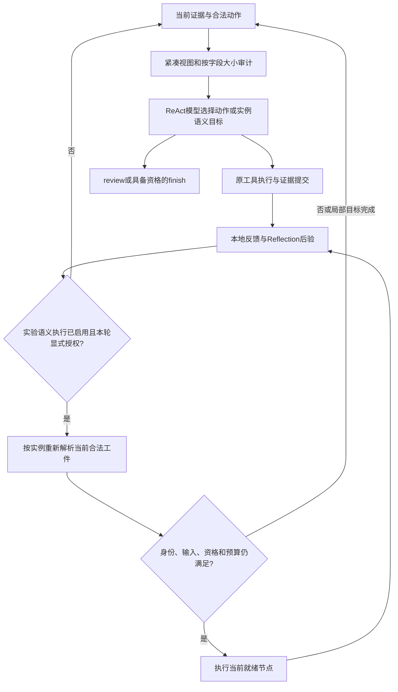

# D3｜紧凑上下文、任务内反思和实验串行语义执行

2026-11-17｜D3-001｜D3已交付：458项回归（457通过、1历史case缺失跳过）、原B59/21/125断言通过；未调用真实视觉API。

后续D3-LIVE-FIX-001真实单图修复及复测见[测试总结（归档）](../运行结果/测试运行总报告.md#archive-case-12)。当前回归466项（465通过/1 skip）；本文458项是D3初交付记录，不替代后续记录。

## 1. 目的与范围

面向融合链路开发、测试与后续D4实施者。按[方案10](10_ReAct主导的证据优化与语义DAG实施部署方案.md)的D3，交付S3和最小S4；遵守[09边界](09_DAG与旧短计划边界.md)及[13最新调查自主性](13_调查建议与硬约束分离.md)。

默认仍为单步ReAct。没有引入LLMCompiler依赖，也没有恢复模型提前写具体工具序列的旧短计划。D4并行、read_set/epoch、事件总线与生产切换不在本批。

## 2. 实际控制链



语义执行只是一次被授权的实例目标。它不会取消其他候选分支，不授予最终确认；review一直可申请，原预算与有界无进展收尾保留。

## 3. 紧凑上下文

真实接口为`planning_context.compact(context, previous=None)`。它返回新视图、仅含指纹的cursor和审计信息，不修改输入。

- 保留每图各折Top-K、完整候选并集及全部知识库ID。最多6个候选的详细显示窗口只影响呈现，不删候选、不改变动作权限；模型可重新激活其他候选。
- 省略重复技能、动作配置哈希、原始操作历史和全知识库暂定排序；当前判据、质量/身份、预算和引用资格仍可见。
- 当前显式读取的详情不被再次隐藏；大型过期读取可以摘要化并标记stale。完整候选、暂定排序和观察分别通过`read_evidence_detail(kind=candidate_catalog|provisional|observations)`分页读取。
- `context_profile`记录各字段压缩前后UTF-8 JSON字节数；真实LLM请求另记`request_profile`。实际token仍只取模型返回usage，不把字节数冒充token。

## 4. Reflection Controller v1

接口：`ReflectionController.record(...)`、`propose(state, threshold=2)`、`apply(patch, selected=None)`及`finalize(reason)`。工件为`workflow/reflection_controller.json`。

触发依据来自实际执行反馈、同键/同问题重复、连续无进展，以及连续4个动作前两候选的判据/分数不变。候选停滞仅是建议，不会把有效负观察变成阳性或自动排除候选。反思包含失败类型、受影响候选、证据版本、需改变的条件、建议补丁、预期收益和停止条件。

模型可在下一次正常规划中附`reflection_patch`：

```json
{
  "reflection_id": "reflection:当前ID",
  "change_condition": "different_input",
  "avoid_action_keys": ["已观察失败的精确键"],
  "activate_candidates": [],
  "recommended_exit": "continue"
}
```

条件为封闭枚举：different_input/different_method/different_view/switch_question/stop。补丁不能新增任意屏蔽键、未知候选、质量授权或判据字段；候选激活仍经过原假设接口，并在当前动作完成后生效。

下一动作后验同时检查“承诺的条件是否改变”和“是否有新信息”。更换文件名不算新输入，单纯输出反思文字不算策略优化。无效补丁/过时ID只拒绝该补丁，不额外请求模型，也不否决合法review。后验是机制观察，不是因果改善证明；未发布跨任务记忆、未更新权重。

## 5. 串行语义执行实验

当前模板`agent.workflow.semantic_execution=false`。显式设true才开放`semantic_options`；模型仍先选一个当前合法动作，可以同时提交该实例的语义目标：

```json
{
  "semantic_task": "measure_width",
  "instance_ref": "inst:当前实例ID",
  "problem_id": "本轮调查问题"
}
```

接口为`compile_goal(runtime, goal, selected)`和`next_action(runtime, plan, state)`。封闭目标是verify_identity/measure_length/measure_width/measure_area。节点为身份→mask→用途资格→测量→更新判据，不含未来crop/seg ID，也不接受tool/actions序列。

前置事实由封闭程序谓词实现，未开放模型自定义required_facts表达式或通用图加载API。每个节点前重新绑定当前实例、像素、几何和合法动作；非等价裁图多解不任取首个。无关证据版本变化不必废弃目标；实际输入变化、身份拒绝、mask review、用途不合格、取消、预算或截止会停止后继并交回ReAct。

测量文件存在并不等于目标完成：只认对应实例、当前分割和测量依赖下的有限正值；请求宽度但只有长度时返回`requested_dimension_unavailable`，不重复测量或假报完成。量纲归类复用`purpose_evidence.dimension_use`，抽取前后12组字段解释逐项一致。

节点保存受信`required_facts`名称；晚绑定指纹包含完整几何映射，不能仅靠同一bbox认定输入不变。既有YOLO与观察并行组合分别记录子动作反馈，成功子动作不掩盖另一条失败；本批没有新增D4并行调度器。

继承现有MCP/LocalToolbox执行和证据提交；没有新建另一套分割、测量、评分或工件写入器。`semantic_node_bound`记录实际工具/对象/版本，`semantic_return`及`workflow/semantic_plan.json`记录回交原因。

## 6. 验收与限制

.venv运行环境未变。统一命令仍为`.venv\Scripts\python.exe -X utf8 -m TCM_Fusion.cli.main selftest`。新增25项回归覆盖逐折候选保留、显式详情可取回、反思越权/后验、默认关闭、晚绑定、身份/QA/标定/预算/取消、回交及真实stdio MCP详情转发。

最终selftest测试171.513秒，整命令175.422秒，退出0。证据位于项目根`results/ui_out/fusion/verification/D3_20261117/`：

- `context_characterization.json`：同一当前上下文116421→36379 UTF-8 JSON字节，减少68.75%；保留逐折候选，非实际token对照。
- `serial_characterization.json`：明确模拟后端，单步4次规划与语义2次规划，测量记录和规则结果一致；不是实际API提效或准确率证明。
- 两份fixture目录内有可查阅的trace与语义节点产物，均明确simulation=true。
- `verification.json`及最终全量日志为交付口径；初轮失败和修正过程保留。

真实模型能否稳定生成合格补丁、选择有价值的语义目标，以及真实费用/耗时/质量非劣性，仍需D5独立实验。没有风险验收线时只称实验能力可运行。

变更记录：v1.0｜2026-11-17｜按D3实施S3与默认关闭的最小串行S4，保留ReAct控制与原证据边界。

### EFF-001 后续修订（2026-11-17）

基于D3真实运行补齐稳定语义问题、执行前绑定、证据/能力/诊断分轴进展、补丁no-op和退出后验；进一步压缩重复状态，增加可选合法presence双路执行与计时。最新485项（484通过/1历史case缺失跳过）及B59/21/125通过，以上458项保留为原批历史结果。详见[15](15_调查效率与反思收益优化.md)。本次不改变语义执行默认false，也不将观察并发称为完整D4。
