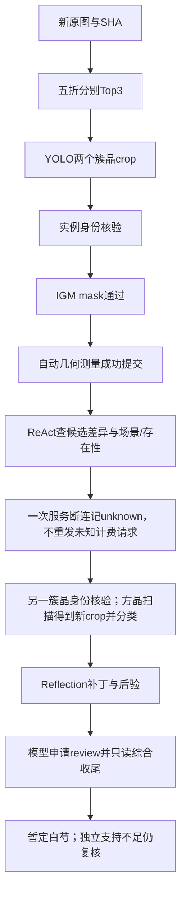

# D3 单图真实复测：修复后

2026-11-17｜D3-LIVE-FIX-001。输入B20180126.jpg，参考目录标签白芍仅作事后核对，未作为真值回流到规划。五折各自Top3，空A缓存与全新YOLO/分类/分割/测量，不续用旧快照。semantic_execution仅本次开启，项目默认仍false。

## 结果与层级

- 接口 408.594 秒；13次规划请求、5次观察额度预约，停止原因`planner_request_review`。
- 本次簇晶最大Feret为17.342455μm，宽度6.967724μm，面积179.800696μm²，px_per_um=11.65。数值来自真实mask与原measure.py；不等于人工参考真值或测量精度已验证。
- 规则簇晶判据IN_RANGE，原规则记录confirmed且needs_review（单类条件放行）；对外仍`tentative / 白芍`，已验证独立特征仅1类，低于当前代码要求2类。不能简称“已经确认白芍”。
- 模型收尾候选与交付候选一致；自由文本数值触发现有numeric_guard，发布程序化状态解释，原模型回复保留审计。
- 2次Reflection补丁被真实模型采用；后验未证明额外有效证据，不能称自我进化或准确率提升。

## 实际执行链

逐动作事实、实际失败码、语义目标回交及usage以agent_trace.json与workflow/operations.json为准；图表示发生过的主要阶段，不表示人为固定顺序。

## 修复验证与剩余问题

1. 自动测量已有受信预算上下文文件，不再传{}；本次测量done并入证据版本，未发生该路径伪超时。
2. 交付若改选候选，解释、支持/反证和has_admitted_b_support由同一候选重建；模型原提案仅审计。跨候选场景由离线回归覆盖，本次收尾两者同为白芍。
3. 本次可选反思一次schema拒绝，动作继续；后续两个补丁成功应用。补丁没产出有效新信息，记录effective=false，未篡改为成功。运行后另补validator/field_path/missing_fields字段级诊断，离线回归验证；不回写本次历史日志，也未为此再付费重跑。
4. 糊化淀粉补查发生UPSTREAM_REMOTE_DISCONNECTED，accepted=false且present=null；这是实际服务故障，与原本地类型错误不同。本轮未自动重试图像请求。
5. 方晶扫描得到新crop，但独立分类返回unreadable，未将其作为方晶存在或尺寸证据；低纹理提示放松不等于取消身份核验。
6. 单图不同生成结果及模型不同调查路线，不能直接用本次与旧运行的时间/token差异证明性能改善。

## 原始工件

- [正式运行报告](runs/fusion_659cdaca5bff4e45afbe4a94b6412bb0/report.md)
- [完整ReAct事件](runs/fusion_659cdaca5bff4e45afbe4a94b6412bb0/agent_trace.json)
- [收尾候选与引用](runs/fusion_659cdaca5bff4e45afbe4a94b6412bb0/final_assessment.json)
- [证据包](runs/fusion_659cdaca5bff4e45afbe4a94b6412bb0/final_evidence.json)
- [反思补丁及后验](runs/fusion_659cdaca5bff4e45afbe4a94b6412bb0/workflow/reflection_controller.json)
- [簇晶mask](runs/fusion_659cdaca5bff4e45afbe4a94b6412bb0/workflow/ops/70e81d0ea2842072/segmentation/masks/view_01__cluster_crystal__inst01.png)
- [YOLO裁图 cluster_crystal_view_01_01](runs/fusion_659cdaca5bff4e45afbe4a94b6412bb0/workflow/ops/19f8de0fedef6cca/detection/crops/cluster_crystal_view_01_01.png)
- [YOLO裁图 cluster_crystal_view_01_02](runs/fusion_659cdaca5bff4e45afbe4a94b6412bb0/workflow/ops/19f8de0fedef6cca/detection/crops/cluster_crystal_view_01_02.png)
- [真实测量JSONL](runs/fusion_659cdaca5bff4e45afbe4a94b6412bb0/workflow/ops/70e81d0ea2842072/auto_measure/measurement/result_measurements.jsonl)

## 补充诊断：反思补丁与耗时（2026-11-17，仅方案，尚未改业务代码）

两次补丁不等于两次有效策略改变。第一补丁避让已完成的方晶扫描并激活已经investigating的G3，随后只对扫描得到的同一crop分类；激活scope_changed=false，扫描到分类属于同一调查问题的不同阶段。分类返回unreadable，无合格存在/尺寸证据。第二补丁避让场景、断连观察、扫描及其crop分类，仍重复激活G3并建议review；模型实际review，但声明change_condition=switch_question，因此收尾后验false。退出建议得到执行，应与获得新证据分别评价，不能将二者揉成一个effective。

代码还存在两处反馈语义问题：switch_question仅比较不同工具形成的problem_id字符串；feature_scan产出crop时，原反馈capability_progress/useful=true，但investigation_progress=false。前者可能误认切换问题，后者可能把可继续验证的新定位当作无进展。建议统一语义问题ID与多轴进展，保留身份/量纲硬门，不把unreadable当阴性。

耗时：A=8.655秒；各工具feedback.latency合计195.142秒，包括初检17.328、分类27.407、分割及内嵌测量25.593、场景7.781、presence105.689、方晶扫描11.344。自动测量行latency=0是未单独打点，不能解释成真实耗时为零。另204.797秒包含规划、收尾、doctor/启动/MCP和本地评分序列化；缺少逐次规划计时，不能全算模型耗时。其中一次presence断连等待62.141秒。首次簇晶测量在工作流开始后约79秒完成，其后仍花约五分钟处理候选调查和收尾。

统计纠正：规划13请求=329522 token，其中输入324960、输出4562；收尾另22328。先前派生summary把final_assessment事件混入planning字段，已按phase修正；二者合计351850仍不是所有视觉工具总token。四次成功原图观察另返回11832，分割/扫描等未全部汇总，不补造总数。每轮压缩上下文仍61306→78260 UTF-8字节，输入token约2.12万→2.82万；顶层supporting_gaps平均8848字节仍反复携带。不能把已有压缩等同低token。

建议顺序：①统一语义问题ID、能力/证据/诊断/退出进展与补丁no-op识别；②补全planner/HTTP/本地计时、去重当前上下文字段并保留按需详情；③让模型选择真正覆盖身份—mask—测量的实例语义目标，隔离可选假设元数据的错误而不重问合法动作；④D4仅执行模型授权且依赖独立的就绪任务，单写者提交证据，服务失败不堵其他分支；⑤以新case和独立输入验证耗时、token、已采信判据和错误结论。不给药材或特征写固定调查顺序，不增加多个思考Agent，不擅自放宽规则或借历史快照冒充在线验证。

详细机器可读诊断：项目根results/ui_out/fusion/verification/D3_LIVE_FIX_20261117/reflection_latency_audit.json。以上均为读码/日志结论与待实施建议，未再次调用API。
