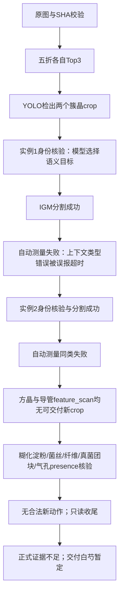

# D3 单图真实运行：修复前参考

2026-11-17｜输入 B20180126.jpg；目录参考标签白芍，仅事后核对，未传入Agent。新case、空A缓存，无历史B工件复用，semantic_execution仅本次显式开启。

## 实际结果

- 接口344.422秒、pipeline342.127秒；12次规划、5次presence观察，12个模型选择步骤。
- 正式规则insufficient_evidence，交付tentative白芍，必须复核；不能称确认白芍。
- 两份簇晶mask通过原分割检查，但自动测量均失败；所需尺寸未入账。
- 身份语义目标由模型主动选择，local_goal_satisfied后回交ReAct；有4张反思卡、1次补丁拒绝、0次补丁生效，不能称完成自我改进。
- 规划返回usage合计291878 token；另收尾22088 token。不是包含检测、分割等所有API的总计，也不是与旧版本受控比较。

## 真实链路

五折第一名分别为白芍、白芍、白芍、白芍、玄明粉；每折Top3完整保留在a_prediction.json，未用平均榜替代Agent输入。

## 本次发现与后续修复边界

1. 自动测量传入{}，受控进程需要预算上下文文件路径；TypeError被广泛异常处理统一改为WORKFLOW_TIMEOUT。180秒是配置上限，不能从该错误码认定实际等待180秒或API无响应。
2. 模型原收尾提议郁金，程序按已有provisional策略改选白芍，却沿用郁金解释及支持引用。该报告存在候选/解释不一致，不能作为诊断正确性证据；原始文件保留以供审计。
3. 反思只留REFLECTION_SCOPE，未记录是哪类字段越界。无法回溯判定具体模型错误字段，不编造原因。
4. 已分割不等于已满足定量判据；原收尾把“无正式测量”描述成“未检出簇晶”存在语义混淆。

修复见TCM_Fusion/修改记录.md的D3-LIVE-FIX-001；该历史case不覆盖，不向其补写测量。修复后重建独立case验证。

## 工件入口

- [原始报告](runs/fusion_cec0ffc6280c49ac80f04d5061bcf2fe/report.md)
- [完整事件](runs/fusion_cec0ffc6280c49ac80f04d5061bcf2fe/agent_trace.json)
- [证据包](runs/fusion_cec0ffc6280c49ac80f04d5061bcf2fe/final_evidence.json)
- [原始收尾提案与交付](runs/fusion_cec0ffc6280c49ac80f04d5061bcf2fe/final_assessment.json)
- [簇晶mask 0dad82c3b72d6926](runs/fusion_cec0ffc6280c49ac80f04d5061bcf2fe/workflow/ops/0dad82c3b72d6926/segmentation/masks/view_01__cluster_crystal__inst01.png)
- [簇晶mask 99b2ddf9c5e1f964](runs/fusion_cec0ffc6280c49ac80f04d5061bcf2fe/workflow/ops/99b2ddf9c5e1f964/segmentation/masks/view_01__cluster_crystal__inst01.png)
